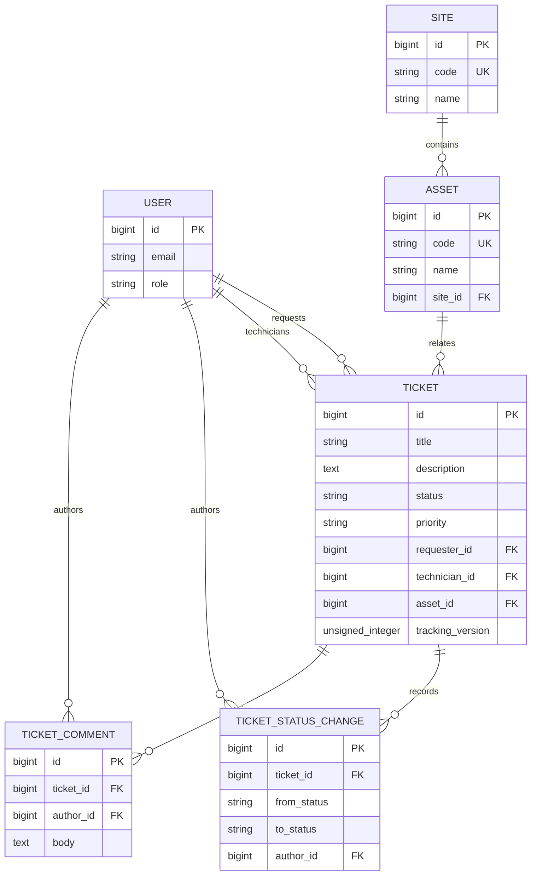

# Domain Data Model and Persistence Invariants

The migrations are the persistence contract. Eloquent models provide typed enum casts, relationships, and query defaults, but they do not replace the database constraints. The current schema stores users and their roles, tickets and their optional asset assignment, append-only status history, comments, sites, and assets.

## Entity relationships

*The diagram shows the persisted foreign-key relationships; `technician_id` and `asset_id` are nullable on a ticket.*

### Core entities

- **User** is the authentication principal. The `role` string defaults to `requester` and is cast to `UserRole`, whose values are `admin`, `technician`, and `requester`. The model hides password and remember-token fields and casts passwords as hashed values. Ticket requester and technician references both point to `users`; role-based visibility is applied by `Ticket::scopeVisibleTo`, which restricts requesters to their own `requester_id`.
- **Ticket** stores a title (maximum 200 characters), description, string status (default `proposed`), string priority (default `medium`), mandatory requester, optional technician, optional asset, an unsigned `tracking_version` (default `0`), and timestamps. Its model casts status and priority to enums and exposes the asset, requester, technician, status-history, and comment relationships.
- **Site** has a unique code (maximum 50), a name (maximum 200), and many assets. **Asset** has a unique code (maximum 50), a name (maximum 200), and a mandatory site. An asset can be associated with many tickets; its model label combines code, name, and the related site name.
- **TicketStatusChange** records `from_status`, `to_status`, the ticket, the author, and timestamps. **TicketComment** records a ticket, author, plain body text, and timestamps. Both history records use enum casts in the model for status values where applicable.

## Enums and lifecycle representation

The database columns are strings rather than database-native enum types. Application enums define the accepted domain values and presentation labels:

| Field | Values | Persistence behavior |
|---|---|---|
| `User.role` | `admin`, `technician`, `requester` | Defaults to `requester`; cast by `User` |
| `Ticket.status` | `proposed`, `open`, `in_progress`, `resolved`, `closed` | Defaults to `proposed`; cast by `Ticket` and status-history model |
| `Ticket.priority` | `low`, `medium`, `high`, `critical` | Defaults to `medium`; cast by `Ticket` |

`TicketStatus::next()` defines the one-way sequence proposed → open → in progress → resolved → closed. The transition action checks that the target is exactly the next status, requires a technician before entering `in_progress`, increments `tracking_version`, and creates a status-change row in the same transaction. Closing therefore does not erase or rewrite the history.

## Ordering, concurrency, and historical references

`Ticket::statusChanges()` and `Ticket::comments()` impose deterministic chronological ordering: `created_at`, then `id`. The corresponding migrations add `(ticket_id, created_at, id)` indexes, supporting the same per-ticket ordering while making equal-timestamp rows stable. The application does not rely on an ambiguous timestamp-only order.

`tracking_version` is the ticket’s optimistic-concurrency token for assignment and status actions. Those actions lock the current ticket row, compare the submitted expected version, increment the version on success, and reject a stale action rather than silently overwriting a concurrent change. Assignment changes the version without creating status history; a valid status transition changes both the ticket and its history in one transaction.

Status changes and comments are historical references, not disposable child data. Their author and ticket foreign keys use `restrictOnDelete()`, as do ticket requester and technician references, the ticket asset reference, and asset site reference. Consequently:

- A user referenced by a ticket, status change, or comment cannot be deleted while the reference exists.
- A ticket with status history or comments cannot be deleted through the database relationship.
- An asset referenced by a ticket cannot be deleted, and a site with assets cannot be deleted.
- There are no cascade deletes in these domain migrations. Retention and historical integrity win over convenient parent deletion; any future anonymization or archival policy must preserve or deliberately revise these constraints.

## Migration evolution and source-of-truth caveat

The schema was introduced in stages rather than as one static model:

1. The user migration adds the role column, defaulting existing and new users to `requester`.
2. `2026_11_16_000001_create_tickets_table.php` creates tickets with requester and optional technician foreign keys, status and priority defaults, indexes, and `tracking_version`.
3. The next migrations add status history and comments, each with restricted ticket and user foreign keys and the chronological composite index.
4. `2026_11_16_000005_create_sites_and_assets.php` adds unique-coded sites and assets with a restricted asset-to-site foreign key.
5. `2026_11_16_000006_add_asset_to_tickets.php` evolves tickets with a nullable, indexed, restricted `asset_id`, preserving tickets that predate asset linkage.

The older README is not a complete description of the current persistence model: its “No hay, a propósito” list still says there are no sites or assets, while the current migrations and models do create them and link assets to tickets. Use the migration files and current models when changing schema or planning data operations. The separate user-administration preparation migration also normalizes existing email addresses and fails on normalized duplicates before creating its administration lock, so migration order and preflight data quality matter.

## Safe extension guidance

Schema changes should be new forward and reversible migrations, with foreign-key deletion behavior chosen explicitly. When adding a relationship to a historical entity, prefer a nullable link for records that predate the feature and add an index consistent with its access pattern. If changing status or priority values, update the application enum, validation/UI behavior, and any historical interpretation together; string columns alone do not enforce the enum set. If adding a ticket action that can race with assignment or transition, participate in the existing row-lock and `tracking_version` protocol rather than issuing an unguarded update.

Related context: [ticket lifecycle](../workflows/ticket-lifecycle.md), [catalog and user administration](../concepts/catalog-and-user-administration.md), and [test strategy](../testing/test-strategy.md).
