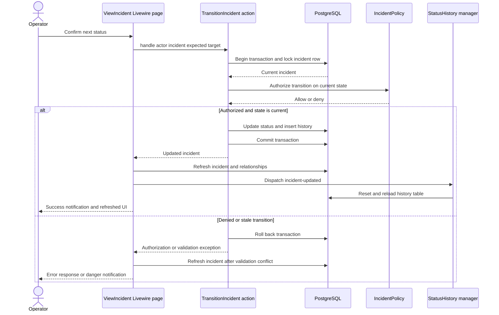

# InfraTicket Panel Architecture

InfraTicket is a server-rendered Laravel application whose `/admin` surface is assembled by Filament and made interactive by Livewire. Filament resources describe forms, tables, record pages, and relation managers; application actions own incident mutations; Eloquent models own relationships and role-scoped queries; policies decide whether the authenticated user may perform an operation; and the configured relational database persists the result. In the containerized development stack that database is PostgreSQL 16.

This page focuses on those architectural boundaries. For business rules and status semantics, see [Incident Domain](../concepts/incident-domain.md) and [Incident Management](../workflows/incident-management.md). For startup and command details, see [Local Development](../operations/local-development.md).

## Panel composition and request boundary

`AdminPanelProvider` is registered as an application provider in [`bootstrap/providers.php`](../../web/bootstrap/providers.php). It defines the default panel with ID `admin`, mounts it at `/admin`, enables Filament's login page, and adds the session, CSRF, route-binding, and Filament middleware before the Filament authentication middleware. A user must therefore have an authenticated session to reach panel pages. `User::canAccessPanel()` currently returns `true`, so every authenticated application role can enter the panel; fine-grained access is enforced per feature rather than at panel admission.

The provider discovers:

- resources under `app/Filament/Resources` in the `App\Filament\Resources` namespace;
- custom pages under `app/Filament/Pages`;
- widgets under `app/Filament/Widgets`;
- plus the explicitly registered Filament dashboard and account widget.

Consequently, [`IncidentResource`](../../web/app/Filament/Resources/Incidents/IncidentResource.php) becomes panel navigation and contributes list, create, and view routes without a separate route declaration. Its page map deliberately has no edit route. The resource also attaches the status-history and comments relation managers to the view page.

## Read path: resource query, Eloquent, and policies

`IncidentResource` is the read-side adapter for the incident UI. It defines the searchable and filterable list, creation schema, detail infolist, eager-loaded user relationships, and default descending ID order. Its base query calls `Incident::visibleTo(auth()->user())` and eager-loads `requester` and `technician`:

- a requester receives a `requester_id = current user` predicate;
- technicians and administrators receive no additional visibility predicate.

This query scope prevents another requester's records from appearing in lists and from being resolved through the resource's record query. `IncidentPolicy::view()` independently applies the corresponding object-level rule: requesters may view only their own incident, while staff may view any incident. Relation managers also call the incident `view` gate before mounting. These layers are complementary: query scoping limits what can be selected, while policy checks protect operations on a specific model.

The policy allows all authenticated roles to list and create incidents. Assignment is allowed to administrators, or to a technician only while the incident is unassigned. Transition is allowed to administrators or the currently assigned technician. Generic incident update and deletion are denied. `IncidentCommentPolicy` delegates view and create decisions to incident visibility and denies update and deletion, which keeps comments append-only through this interface.

> **Security boundary:** hiding or showing a Filament button is a usability decision, not authorization. Every mutation must be authorized server-side by its Filament action and, critically, by the application action that can also be called outside the UI. New entrypoints must invoke the same authorized application actions or perform equivalent policy checks; a `visible()` callback alone is never sufficient.

## Write path: Livewire delegates to application actions

Filament pages and relation managers collect input and orchestrate feedback, but do not directly implement incident rules:

- `CreateIncident` overrides `handleRecordCreation()` and invokes `App\Actions\Incidents\CreateIncident`. The action authorizes creation, trims and validates its accepted fields, ignores caller attempts to select requester, technician, or status, and creates an incident for the actor in `proposed` state with no technician. Validation keys are remapped to Filament's `data.*` form state before being shown. A successful create redirects to the view page.
- `ViewIncident` exposes assign, self-assign, and next-status actions. Filament `authorize()` checks guard invocation, and the application actions repeat authorization against server-side state. The technician selector is populated only from users with the technician role.
- `CommentsRelationManager` invokes `CommentOnIncident`, which reloads the incident, authorizes comment creation, validates and trims the body, and creates it through the incident relationship. It then resets its table.

`AssignIncident` and `TransitionIncident` use database transactions and row locks. Assignment reloads the incident with `lockForUpdate()`, reauthorizes the current state, prevents a technician from assigning another user, validates that the target really is a technician, and updates `technician_id`. Transition similarly locks and reloads the incident, authorizes it, compares the current status with the status captured when the confirmation was mounted, accepts only `status->next()`, and requires an assignee before entering `in_progress`. Updating the incident and appending its status-history row happen in one transaction.

*The transition flow reauthorizes locked state, persists the incident and audit row atomically, then refreshes the Livewire view and history.*

`ViewIncident::performChange()` handles validation conflicts from assign or transition by sending a danger notification, refreshing the model and eager-loaded users, and halting the Filament action. On success it refreshes the record, dispatches `incident-updated`, and sends a success notification. `StatusHistoryRelationManager` listens for that event and resets only when the event's incident ID matches its owner. This matters for stale confirmations: another request may have advanced the incident after a modal opened, so the action rejects the old expected status rather than creating duplicate history.

Authorization failures are not converted into validation notifications by `performChange()`; they remain authorization failures. That distinction is intentional: a stale but permitted operation is recoverable UI feedback, whereas an unauthorized call must fail closed.

## Persistence model and database invariants

The Eloquent model is the shared persistence vocabulary:

- `Incident` casts status and priority to enums and belongs to requester and optional technician users.
- It has ordered `statusHistory` and `comments` collections; both order by `created_at` and then `id` for deterministic chronology.
- `IncidentStatusHistory` casts old and new status values to the status enum and belongs to an actor.
- `IncidentComment` belongs to an author.

The migrations back these relationships with foreign keys. Deleting an incident cascades to its history and comments, while referenced requester, technician, actor, and author users are protected with restricted deletion. The incident table indexes status and priority together and indexes both user references; child tables index incident, creation time, and ID to support their ordered relation-manager queries.

Not every domain invariant is a database constraint. Status progression, role eligibility, and the requirement for an assignee before `in_progress` live in application actions, while enum casts constrain the application representation. Code that writes directly through Eloquent can bypass those action-level rules, so mutation extensions should go through the actions rather than treating the models as an unrestricted service API.

## Theme and asset pipeline

The panel provider registers `resources/css/filament/admin/theme.css` with `viteTheme()`, sets the InfraTicket brand view and primary color, loads Rubik through Filament's `LocalFontProvider`, and calls `darkMode(false)`. The theme also declares `color-scheme: light`, so the application intentionally presents light operational surfaces even when a browser has retained a dark preference.

Rubik is not fetched from a CDN. [`public/fonts/rubik/fonts.css`](../../web/public/fonts/rubik/fonts.css) declares the local variable font at `rubik-latin-variable.ttf`; the provider addresses that stylesheet through `asset('fonts/rubik/fonts.css')`. The custom theme imports Filament's base theme and declares `@source` paths for application Filament classes and Filament views, then layers the responsive, focus, color, and component treatment needed by the panel. It should be changed as a coherent theme rather than copied into individual resources.

[`vite.config.js`](../../web/vite.config.js) lists the admin theme alongside the application CSS and JavaScript and runs both the Laravel Vite and Tailwind CSS plugins. This creates an important host/container distinction:

- The application container mounts the project at `/app`, but Composer dependencies live in the `infraticket-vendor` volume. A Node build run in a container sharing the app's volumes can resolve the theme import directly and emit `public/build` into the mounted project.
- A host-side Node build cannot see that Composer volume. Before `npm ci && npm run build`, copy the container's `vendor/filament` subtree into the host's ignored `vendor/filament` path so the CSS import resolves. Copy it again after upgrading Filament.
- `npm run dev` provides HMR. Stop it and run `npm run build` for static assets; remove a stale `public/hot` if an interrupted dev server causes Laravel to keep looking for HMR.

See [Local Development](../operations/local-development.md) for the exact Docker and Podman commands. `public/build` is generated output and is not the source of the theme.

## Safe extension points

When adding a panel capability:

1. Put presentation and Livewire refresh behavior in the resource page or relation manager.
2. Add or amend a policy ability for object-level authorization and use resource query scoping for collection visibility.
3. Put validation, protected defaults, locking, state transitions, and writes in an application action. Reauthorize after acquiring a lock when authorization depends on mutable state.
4. Express relationships, casts, stable ordering, and reusable read scopes on Eloquent models; add migration constraints and indexes where the database can enforce the invariant.
5. Refresh the owner record or relation table after a mutation, and use a narrowly identified Livewire event when sibling components must refresh.
6. Add both action-level tests and Livewire tests. Do not validate security only by asserting that a control is hidden.

Adding a class below the configured discovery directories is enough for Filament to find it, but discovery is not permission registration. A discovered resource still needs appropriate policies, queries, and authenticated action paths.

## Focused validation

The highest-value checks are split across layers:

- `IncidentAccessTest` exercises protected creation defaults, validation, role-scoped reads, and denied generic mutations.
- `IncidentPanelTest` drives Livewire creation, combined table filters, unauthenticated redirects, direct-record isolation, absent edit routes, escaping, and form errors.
- `IncidentTrackingPanelTest` covers admin assignment, technician self-assignment, hidden and non-mountable unauthorized actions, history display, and stale confirmation behavior.
- `IncidentCommentsPanelTest` covers relation-manager authorization, escaped append-only comments, validation, and stable pagination.
- `IncidentPersistenceTest` checks enum and relationship persistence plus foreign-key restrictions.

The normal suite uses SQLite in memory, which is fast for policy, Livewire, and persistence behavior. Row-lock correctness depends on PostgreSQL semantics, so the repository also provides `tests/Support/check-postgres-concurrency.php` to exercise competing auto-assignment and transition attempts against a temporary PostgreSQL database. Use both layers when changing transaction or concurrency behavior; see [Validation Strategy](../testing/validation-strategy.md).
