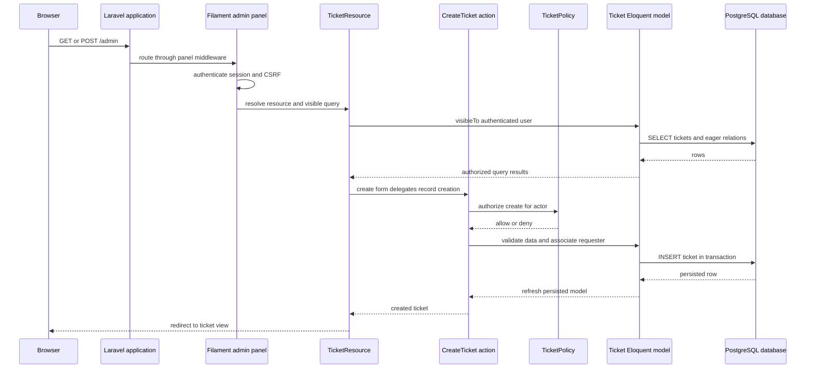

# System Boundaries and Runtime Composition

InfraTicket is a Laravel 13 application with Filament 5 as its browser-facing administration panel. The repository does not define a separate application HTTP API: `/` redirects to `/admin`, and the panel owns the authenticated user experience. Laravel bootstraps the web route file and health route in `bootstrap/app.php`; Composer supplies the framework and Filament packages, while PSR-4 autoloading maps `App\` to `app/`.

## Runtime shape

The normal local runtime is two Docker Compose services:

- `app` builds the application image, bind-mounts the repository at `/app`, keeps Composer dependencies in the `infraticket-vendor` volume, and exposes port `8000`.
- `db` runs PostgreSQL 16 with persistent volume `infraticket-pgdata`. Its health check uses `pg_isready`, and `app` waits for the database service to become healthy.
- Compose injects `DB_HOST=db`. Laravel's `pgsql` connection reads the remaining database settings from environment variables; the default Laravel connection is otherwise SQLite, so the active connection is an operational configuration choice rather than a hard-coded model choice.

The container entrypoint is deliberately part of the lifecycle. `docker/start.sh` installs dependencies when `vendor/autoload.php` is absent, creates `.env`, generates an `APP_KEY` when needed, runs `php artisan migrate --seed --force`, and then starts `php artisan serve` on `0.0.0.0:8000`. `--no-reload` preserves the Compose environment so the server continues using `DB_HOST=db` rather than falling back to the host-oriented `.env` value. A fresh or changed schema therefore belongs in migrations and is applied during startup; it should not be implemented as model-side table creation.

## Request and persistence boundaries

An authenticated request to the admin panel crosses these boundaries:

This diagram shows the authenticated Filament ticket path across the panel, resource, action, policy, model, and database boundaries.

`AdminPanelProvider` declares the `admin` panel at `/admin`, enables login, discovers resources/pages/widgets, and installs session, authentication, CSRF, binding, and Filament-serving middleware. `TicketResource` is the Filament adapter: it names `Ticket` as its model, supplies form/table/infolist configuration, exposes list/create/view/edit pages, and eager-loads `requester`, `technician`, and `asset.site` for its records.

Visibility is intentionally enforced at the query boundary as well as at individual authorization checks. `TicketResource::getEloquentQuery()` calls `Ticket::visibleTo(auth()->user())`; the model scope restricts requesters to their own `requester_id`, while staff see the unrestricted ticket query. `TicketPolicy` separately governs record abilities: requesters can view only their tickets, cannot edit closed tickets or later-state tickets, staff cannot edit closed tickets, only non-requesters can assign, technicians may transition their own assignments, and deletion is denied. Keep both controls when changing visibility or permissions: a policy alone does not prevent an over-broad list query, and a scope alone does not authorize mutations.

## Where creation logic belongs

Filament's `CreateTicket` page overrides `handleRecordCreation()` and delegates to `App\Actions\Tickets\CreateTicket`, rather than embedding business rules in the resource or page. The action is the application boundary for creation:

1. It opens a database transaction.
2. It authorizes `create` for the supplied actor through `Gate::forUser()`.
3. It validates the supported input through `TicketData::validate()`.
4. It constructs a `Ticket` from validated fillable fields and associates the actor as requester.
5. It forces the initial status to `TicketStatus::Proposed`, saves, and refreshes the model.

Consequently, creation rules that must hold for non-UI callers belong in the action and its validation/data object, not only in Filament form fields. The page only translates validation keys to Filament's `data.*` shape and chooses the post-create ticket view redirect. The action's transaction means authorization, validation, insert, and rollback are one unit from the caller's perspective.

## Model and schema ownership

`Ticket` owns Eloquent relationships and query behavior, not the physical schema. It declares `asset`, `requester`, and `technician` belongs-to relations, ordered `statusChanges` and `comments` has-many relations, fillable user-editable attributes, and enum/integer casts for status, priority, and tracking version.

Migrations own the database contract. The tickets migration creates title, description, status, priority, requester and optional technician foreign keys, tracking version, timestamps, and indexes; the later asset migration adds the nullable, indexed, restrict-on-delete `asset_id` foreign key. PostgreSQL enforces these relational constraints. Changes to columns, indexes, foreign keys, or defaults belong in a new reversible migration; changes to query visibility belong in the model scope/resource query; changes to allowed state transitions or actor abilities belong in policies/actions and their focused tests.

For the broader entity relationships and lifecycle, see [Data Model](data-model.md). Authorization and requester/staff visibility are elaborated in [Authorization and Visibility](../concepts/authorization-and-visibility.md).

## Change and operations guide

| Change | Primary boundary | Verify |
| --- | --- | --- |
| Add or alter a persisted field, index, or foreign key | `database/migrations/` and the model cast/fillable or relation as applicable | Run migration reversal/reapplication and PostgreSQL feature tests |
| Change who can list, view, edit, assign, transition, comment, or delete | `TicketPolicy`, model `visibleTo`, and the relevant action | Test each role and ticket state; do not rely only on UI hiding |
| Change ticket creation invariants | `app/Actions/Tickets/CreateTicket.php` and `TicketData` | Test actor identity, validation boundaries, initial status, and transaction behavior |
| Change admin navigation, forms, tables, pages, or panel middleware | `TicketResource` or `AdminPanelProvider` | Exercise an authenticated Filament feature test and browser-facing `/admin` path |
| Change local startup, database host, or persistence | `docker/start.sh`, `docker-compose.yml`, `.env`, and database config | Start from a clean volume when appropriate, check health, migrations, and `/admin` |

The focused feature tests are the executable boundary map: `TicketManagementTest` covers action invariants, visibility, policy decisions, and migration reversal; `TicketResourceTest` and `AdminLoginTest` cover the Filament/authenticated surface; PostgreSQL-specific behavior is covered by `PostgresTicketTest` and `PostgresAdministrationTest`. Use the repository's `composer test` script for the suite; local development and container startup details are also collected in [Local Development](../operations/local-development.md), while test layering is described in [Test Strategy](../testing/test-strategy.md).

## Failure and safety invariants

- Unauthenticated users cannot enter the panel because `Authenticate` is configured as panel auth middleware; session and CSRF middleware protect the stateful admin path.
- A requester cannot obtain another user's tickets by changing a resource URL: the resource query limits the candidate records and `TicketPolicy::view` checks the record again.
- Creation cannot honor client-supplied requester, technician, status, or timestamps: the action derives requester from the actor and sets the initial status, while the action data contract controls accepted fields.
- A database outage or failed migration prevents a healthy application startup rather than silently switching the container to a different database; Compose's health dependency and the entrypoint's `set -e` make readiness and migration failures visible.

Avoid introducing direct database writes in Filament pages, bypassing `Gate` in actions, or relying on a UI-only visibility filter. Those shortcuts cross the established boundaries and can make browser behavior differ from action callers, policy decisions, or PostgreSQL constraints.
