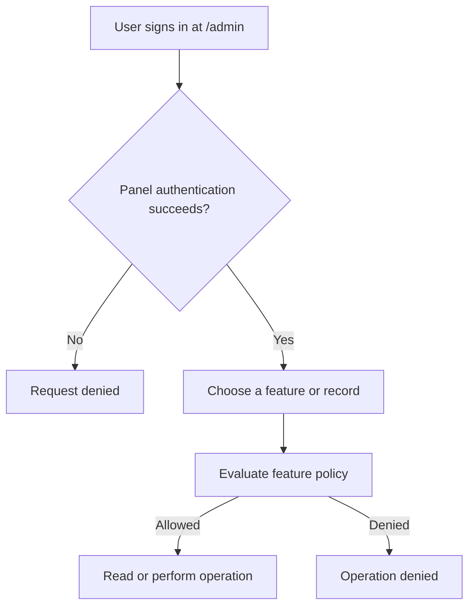

# Roles, Policies, and Record Visibility

InfraTicket has three roles: `admin`, `technician`, and `requester`. The role is an enum cast on `User`, and the application deliberately separates **panel entry** from **what a person may see or do after entry**. This distinction is important: authentication gets a user into the `/admin` panel, while policies and query scopes decide whether a particular feature or record is available.

## Panel authentication is not feature authorization

The Filament panel has the id `admin`, is served at `/admin`, and enables the built-in login page. Its `Authenticate` middleware protects panel requests. `User::canAccessPanel()` currently returns `true` for every authenticated user, so all three roles can sign in. It does not grant them equivalent access inside the panel; resource actions and application actions still invoke the relevant policy.

This shows the boundary between entering the panel and making a feature-level authorization decision.

The `UserPolicy` is the gate for user administration: only administrators may list, view, create, update, or delete users. Its `deleteAny()` remains false, so bulk user deletion is not enabled even though an administrator may delete an individual user when the user-management action's invariants permit it.

## Ticket visibility and capabilities

Ticket visibility has two cooperating layers:

1. `TicketResource::getEloquentQuery()` applies the model's `visibleTo()` scope to the panel's list and record query.
2. `TicketPolicy::view()` checks the individual record as a second boundary.

For a requester, both layers restrict tickets to rows whose `requester_id` is that user's id. A requester therefore cannot list or open another requester's ticket; this is not merely a UI hiding rule. Technicians and administrators have no additional `visibleTo()` restriction and can see all tickets. `viewAny()` and `create()` are true for every authenticated role, so each role can enter the ticket feature and create a ticket; creation uses the acting/session user as the requester rather than trusting a submitted requester identity.

The ticket policy then applies operation-specific rules:

| Operation | Administrator | Technician | Requester |
| --- | --- | --- | --- |
| View tickets | All tickets | All tickets | Own tickets only |
| Create | Yes | Yes | Yes |
| Update | Any non-closed ticket | Any non-closed ticket | Own ticket only while `Proposed` or `Open` |
| Assign | Any non-closed ticket | Any non-closed ticket | No |
| Transition status | Any non-closed ticket | Only a ticket assigned to that technician, while non-closed | No |
| Comment | Any visible, non-closed ticket | Any visible, non-closed ticket | Own, non-closed ticket |
| Delete | No | No | No |

The policy treats `Closed` as terminal for updates, assignment, transitions, and comments. Assignment is available to any non-requester, whereas status transition is intentionally narrower for technicians: the technician must be the ticket's `technician_id`; administrators are not subject to that assignment check. Ticket status and priority are enum-cast model state, and update actions reload and lock the current database row before authorizing, preventing an authorization decision based on a stale status.

The same policy is used by the ticket page's assign and transition actions and by the comments relation manager. The model scope protects collection retrieval, while the policy protects record operations; both must be maintained when extending ticket access.

## Sites and assets

Sites and assets are readable by every authenticated role: their `viewAny()` and `view()` methods return true. Only administrators may create, update, or delete an individual site or asset. `deleteAny()` is false for both resources, so bulk deletion is not authorized.

The catalog actions call the policy through `Gate` before writing. They also validate and normalize catalog data, and deletion rejects records that are still referenced rather than cascading through tickets. The focused feature tests cover administrator maintenance, validation, referenced-record protection, and rejection of requester and technician writes. See [Catalog and User Administration](catalog-and-user-administration.md) for the broader catalog lifecycle.

## User administration safeguards

User policy authorization is necessary but not sufficient for a mutation. The user actions lock the acting user and target row, then authorize against the current actor and record. This prevents a stale administrator object from continuing to perform administrative work after its role has changed.

Additional domain safeguards preserve usable identity and history:

- At least one administrator must remain; the last administrator cannot be deleted or demoted.
- A technician with any non-closed assigned ticket cannot be changed to another role until those tickets are reassigned or closed.
- A user referenced as a ticket requester or technician, or as a comment or status-history author, cannot be deleted. Unreferenced users may be deleted by an authorized administrator.
- User creation and updates normalize identity fields and hash passwords; password and remember-token fields are hidden from serialized user data.

These checks belong in the user actions rather than in the policy alone because they require current database state and cross-record invariants. They are transactional and translate related-record failures into validation errors, preserving the records instead of silently cascading. The corresponding feature tests cover role changes, last-administrator protection, stale actors, and referenced users. See [Catalog and User Administration](catalog-and-user-administration.md) for the operational user-management flow.

## Extension guidance and invariants

When adding a role or feature:

- Update `UserRole` and every feature policy that makes role decisions; panel access should not be used as a substitute for a feature policy.
- For collection-backed resources, apply record scoping in the Eloquent query and retain record-level policy checks. A policy alone does not replace a correctly scoped list query.
- Recheck both the policy and the action/service layer. Actions may reload, lock, validate, or enforce cross-record constraints that a direct policy call does not express.
- Preserve requester isolation: any new ticket list, relation, export, or lookup must use the same ownership rule and must not expose another requester's ticket.

For the ticket state and write workflow, see [Ticket Lifecycle](../workflows/ticket-lifecycle.md). For the application's boundary between the panel and domain operations, see [System Boundaries](../architecture/system-boundaries.md).
