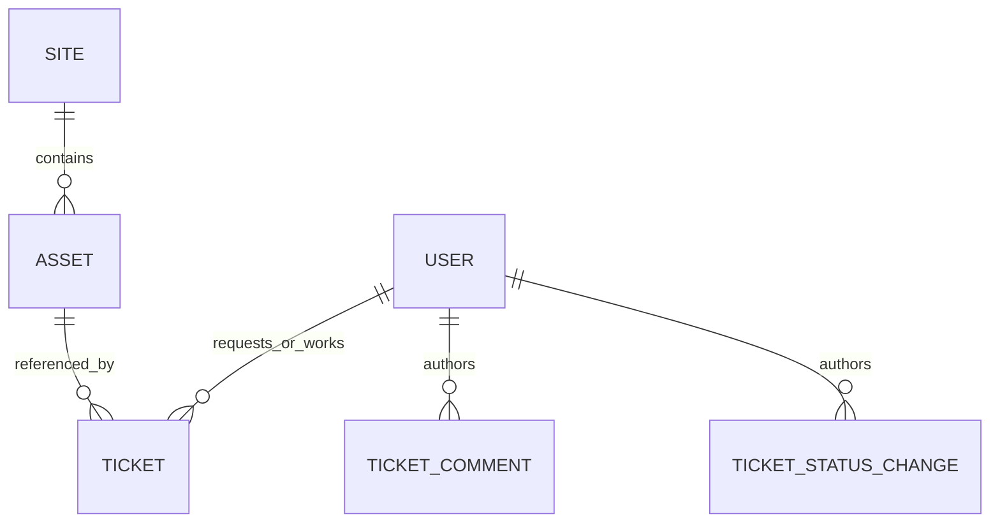
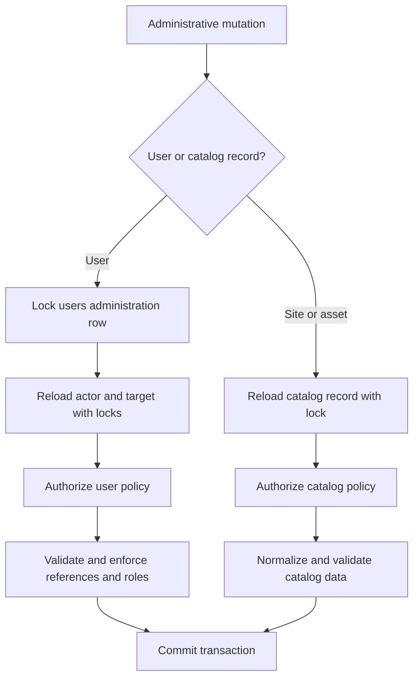

# Users, Sites, and Assets Administration

The application currently implements three administrative resources in the Filament panel: users, sites, and assets. Users are visible only to administrators, while all authenticated panel users can view sites and assets; create, edit, and delete operations for sites and assets are administrator-only. The resources expose list, create, view, and edit pages, but bulk deletion is disabled by the policies. These are implemented catalog and user-management capabilities, not a promise that every related domain object has a management screen. [UserResource](../../web/app/Filament/Resources/Users/UserResource.php), [SiteResource](../../web/app/Filament/Resources/Sites/SiteResource.php), [AssetResource](../../web/app/Filament/Resources/Assets/AssetResource.php), [UserPolicy](../../web/app/Policies/UserPolicy.php), [SitePolicy](../../web/app/Policies/SitePolicy.php), [AssetPolicy](../../web/app/Policies/AssetPolicy.php)

## Resource relationships

A site has many assets. Each asset belongs to one site and has many tickets, and its display label includes the current site's name. The catalog action layer therefore treats `site_id` as a required, existing site reference and supports moving an asset by saving a different site. User references are held by ticket requester and technician fields, ticket comments, and ticket status history; those references are intentionally not cascaded away when a user is removed.

This diagram shows the relationships that affect catalog and user deletion safeguards.

## Action-layer write flow

Filament resources provide the entrypoints, but the important invariants live in action classes. `SaveCatalogRecord` and `DeleteCatalogRecord` run inside database transactions, reload existing records with a row lock, and authorize against the reloaded actor and record. User actions use the same transactional pattern plus the named `users` administration lock, which serializes competing user mutations and refreshes the actor from the database before authorization.

This flow summarizes the action-layer locking, authorization, validation, and commit boundary.

## Users

`CreateUser`, `UpdateUser`, and `DeleteUser` are the supported mutation entrypoints. `UserData` trims names and email, lowercases email, validates the `UserRole` enum, requires a 12-character password on creation, and hashes passwords through the model's cast. On update, an empty password leaves the existing password unchanged. Invalid data raises a validation error before persistence.

Every user mutation first calls `UserAdministration::lock`, which obtains the sole `users` row in `administration_locks` with `lockForUpdate()` and reloads the actor. This matters for stale in-memory actors: a caller whose role was changed after loading cannot use the old role to authorize a mutation. The user action then authorizes through `UserPolicy`; only administrators may view or mutate users. The lock is held inside the transaction, so concurrent user administration observes a consistent ordering.

Two role invariants protect operational continuity:

- At least one administrator must remain. Deleting the last administrator or changing the last administrator to another role fails validation.
- A technician with any non-closed ticket cannot be demoted. The ticket must first be reassigned or closed. Closing the ticket permits the role change; the historical technician reference is retained.

Deletion is also constrained by database relationships and explicit preflight checks. A user referenced as a ticket requester or technician, comment author, or status-change author cannot be deleted. The action converts foreign-key constraint failures into validation errors as a second line of defense. An unreferenced user can be deleted; there is no cascade that silently removes ticket history.

## Sites and assets

`SaveCatalogRecord` is the shared site/asset save action. It trims `code` and `name`, uppercases codes, enforces required strings and maximum lengths, and enforces unique codes. Assets additionally require an integer `site_id` that exists in `sites`; the site is shared-locked and rechecked before the asset is saved, so a disappearing selection is reported as a validation failure rather than creating a dangling reference. Existing assets can be moved between sites by submitting another valid `site_id`.

`DeleteCatalogRecord` authorizes the specific site or asset and refuses deletion when a site still has assets or an asset still has tickets. It also translates relevant SQL integrity errors into validation errors. Thus deletion is non-cascading: a free asset and its now-free site can be removed, while referenced catalog records remain intact.

## What is implemented, and what is not implied

The source and focused feature tests establish working creation, editing, deletion, normalization, role validation, asset movement, and relationship protection for these resources. They do not establish a general-purpose administration UI for tickets, comments, status history, or arbitrary reference cleanup. Those objects participate in safeguards, but their participation should not be read as an implemented management feature here.

The migration tests additionally verify that the `administration_locks` row exists after migrations, that asset/site relationships survive migration reversal and reapplication, and that user-email normalization refuses collisions without changing existing accounts. These are persistence prerequisites for the action-layer guarantees, not user-facing features.

## Focused verification

- `web/tests/Feature/UserManagementTest.php` covers normalization and password behavior, invalid fields, authorization, last-administrator protection, referenced-user deletion, technician demotion, and stale-actor rejection.
- `web/tests/Feature/SitesAndAssetsTest.php` covers normalized uniqueness, required site references, asset movement, non-cascading deletion, and authorization for catalog writes.
- `web/tests/Feature/AdministrationMigrationsTest.php` covers the administration lock row and migration reversibility for user normalization and asset-ticket relationships.
