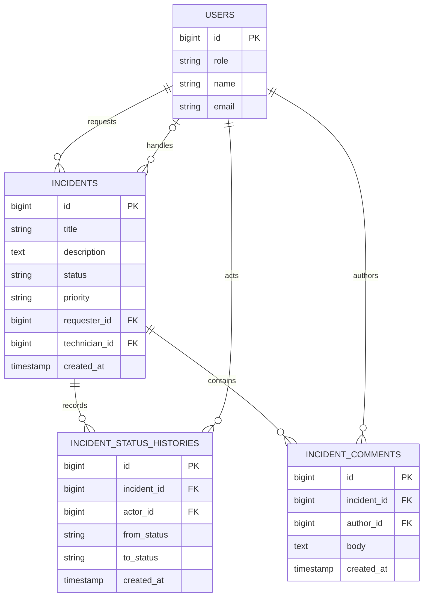
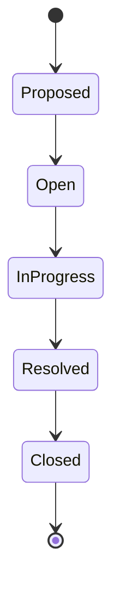

# Incident Domain Model and Authorization

InfraTicket treats an incident as an append-only conversation and status trail around a deliberately non-editable core record. All authenticated roles can submit an incident, but the server owns its requester, initial status, and initial assignment. Subsequent changes go through narrow assignment, transition, and comment actions rather than a general update path. See [Incident Management](../workflows/incident-management.md) for the operator workflow and [InfraTicket Panel](../architecture/infraticket-panel.md) for the UI boundary.

## Entities and relationships

*The ER diagram shows the incident owner and optional assignee, plus actor-attributed status history and author-attributed comments.*

An `Incident` belongs to one requester and optionally one technician. It has many `IncidentStatusHistory` and `IncidentComment` rows. The reverse `User` relationships expose requested incidents, assigned incidents, authored comments, and status changes. `status` and `priority` are stored as strings but cast by Eloquent to `IncidentStatus` and `IncidentPriority`; history endpoints are also cast to `IncidentStatus`. The database columns themselves are not native enum columns, so writes should pass through the domain actions and their enum validation rather than relying on the schema to reject arbitrary strings.

The model orders both child collections by `created_at` ascending and then `id` ascending. The ID tie-breaker makes equal-timestamp history and comment rows deterministic, including across paginated displays. Supporting composite indexes use the same `(incident_id, created_at, id)` shape.

## Enum-backed values

| Concept | Stored values | Behavior |
| --- | --- | --- |
| Role | `admin`, `technician`, `requester` | New users default to `requester`; every role can enter the panel, while policies decide feature access. |
| Priority | `low`, `medium`, `high`, `critical` | Creation defaults to `medium`; priority is not generally editable later. |
| Status | `proposed`, `open`, `in_progress`, `resolved`, `closed` | Creation always starts at `proposed`; only the next sequential state is accepted. |

The lifecycle is intentionally linear:

*An incident can advance one step at a time and cannot skip, regress, or leave `closed`.*

Opening an incident does not require an assignee. Entering `in_progress` does require a non-null technician. Assignment does not itself alter status or add status history. Creation also does not synthesize a history row; history records successful transitions only.

## Authorization model

The list query and record policy enforce the same visibility boundary: a requester sees only incidents whose `requester_id` is their own ID, while administrators and technicians see all incidents. Direct record access and the history/comment relation managers are gated by that incident-level visibility. `viewAny` and `create` are available to every authenticated role.

| Capability | Requester | Technician | Administrator |
| --- | --- | --- | --- |
| Create incident | Yes, attributed to self | Yes, attributed to self | Yes, attributed to self |
| See incidents | Own requests only | All incidents | All incidents |
| Assign technician | No | Self only, and only while unassigned | Any user with technician role; may reassign |
| Advance status | No | Only incidents assigned to self | Any incident, subject to lifecycle invariants |
| Read/add comments | On visible own incidents | On all incidents | On all incidents |
| General edit/delete | No | No | No |

A technician cannot assign another user and cannot take an already assigned incident. An administrator can select only a user whose current role is `technician`. Transition authorization is independent from visibility: an unassigned or differently assigned technician may read an incident but may not transition it. An administrator may advance an incident, although the `in_progress` precondition still requires an assignee.

Comment access delegates to incident visibility. Consequently, any viewer can comment in every status, including `closed`, but an unrelated requester can neither read nor publish comments. Comment update, individual delete, and bulk delete are denied for every role.

## Controlled mutations and attribution

The application actions are the domain mutation boundary:

- [`CreateIncident`](../../web/app/Actions/Incidents/CreateIncident.php) trims and validates user-editable fields, then overrides protected values: `requester_id` is the actor, `status` is `proposed`, and `technician_id` is `null`. Caller-supplied versions of those fields are ignored.
- [`AssignIncident`](../../web/app/Actions/Incidents/AssignIncident.php) authorizes assignment, locks the current incident row, rechecks authorization against that current row, validates the target's technician role, and updates only `technician_id`. A technician's requested target must equal the actor's own ID.
- [`TransitionIncident`](../../web/app/Actions/Incidents/TransitionIncident.php) locks and reloads the incident, authorizes the current record, verifies the caller's expected status, enforces the single-step map and assignment precondition, then writes the status and actor-attributed history in one transaction.
- [`CommentOnIncident`](../../web/app/Actions/Incidents/CommentOnIncident.php) reloads the incident, checks comment creation through incident visibility, validates the body, and creates through the incident relationship with `author_id` taken from the actor.

This means `requester_id`, initial `status`, initial `technician_id`, history `actor_id`, comment `author_id`, child `incident_id`, and normal timestamps are server controlled. Supplying forged attribution, relationship IDs, status, assignment, or timestamps to the public action input does not override those values.

Incidents have **no general edit behavior**: `IncidentPolicy::update` is always false, delete and bulk delete are always false, and the resource registers list, create, and view pages but no edit page. The only supported post-creation mutations are assignment and forward status transition. History entries and comments are likewise immutable through policy. This separation is important even though the Eloquent models list persistence fields as fillable: fillability is not the authorization or domain-invariant boundary.

### Concurrency and atomicity

Assignment and transition use database transactions with `lockForUpdate()` on the current incident. A competing technician self-assignment therefore cannot silently replace the winner; after acquiring the lock, the loser sees an assigned record and receives validation failure. A transition carries an `expectedStatus`, so a stale confirmation fails instead of replaying against a newer state. Status update and history insertion share one transaction: if history creation fails, the status update rolls back as well.

## Validation and failure semantics

| Input | Normalization and accepted limit | Failure |
| --- | --- | --- |
| Incident title | Trimmed, required string, maximum 255 characters | Validation error on `title`; no incident is created |
| Incident description | Trimmed, required string, maximum 10,000 characters | Validation error on `description`; no incident is created |
| Priority | Required `IncidentPriority`; defaults to `medium` | Validation error on `priority` |
| Comment body | Trimmed, required string, maximum 5,000 characters | Validation error on `body`; no comment is created |
| Assignment target | Existing user with role `technician` | Validation error on `technician_id`; unauthorized assignment fails authorization or HTTP 403 |
| Status transition | Current status must equal the expected status and target must equal `current.next()` | Validation error on `status`; no status/history partial write |

Whitespace-only values fail after trimming. Limits are character-oriented Laravel `max` validation and are covered with multibyte input. The Filament forms repeat the same maximums for immediate feedback, but the actions remain authoritative for callers outside the panel. The focused behavior tests are described in [Validation Strategy](../testing/validation-strategy.md).

## Referential and deletion constraints

Foreign-key behavior deliberately differs between identity attribution and incident-owned detail:

- `incidents.requester_id` and nullable `incidents.technician_id` reference users with **restrict on delete**. A referenced requester or technician cannot be deleted.
- `incident_status_histories.actor_id` and `incident_comments.author_id` also use **restrict on delete**, preserving who performed or authored an event.
- History and comment `incident_id` keys use **cascade on delete**, because those rows are owned by the incident.

Application policy denies incident deletion to every role, so the cascade is a persistence safety rule rather than a normal UI operation. If an incident is removed through an external administrative or database path, its history and comments are removed with it; user records referenced anywhere in the incident trail remain protected from deletion. The required requester foreign key also prevents an incident from referencing a nonexistent requester.

## Safe extension points

Keep new interfaces routed through the four actions rather than calling model `update()` or child `create()` directly. New status values require coordinated changes to `IncidentStatus::next()`, transition UI wording, factories, and exhaustive transition tests. New roles require an explicit review of both `visibleTo()` and policies because panel access alone intentionally grants no incident capability. If future requirements introduce editing or deletion, define narrow policy abilities and audit semantics instead of enabling Filament's generic edit/delete actions; otherwise protected attribution and the immutable trail can be bypassed.
