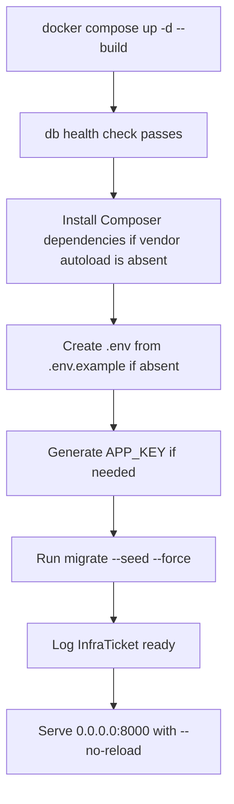
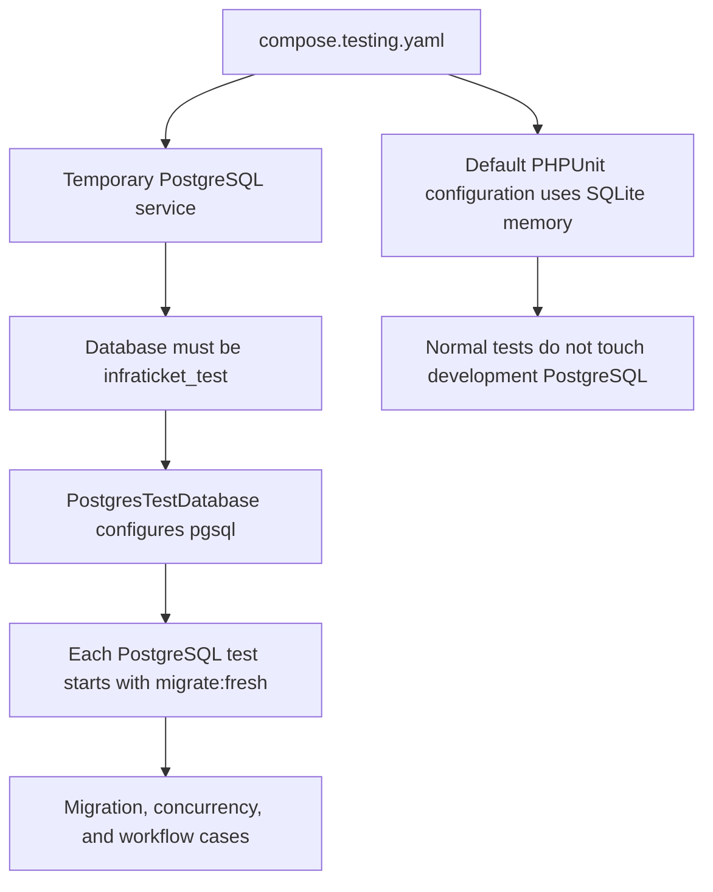

# Local Runtime, Configuration, and Recovery

This guide covers the supported development runtime in `web/`. Docker Desktop (or Docker in WSL2) is sufficient: PHP, Composer, and the PHP extensions are supplied by the application image. Podman can be used by replacing `docker` with `podman` in the commands below. For system boundaries and the wider application model, see [System boundaries](../architecture/system-boundaries.md); the user-facing quick start is [Quickstart](../quickstart.md).

## How the development stack starts

From the repository's `web/` directory, build and start the stack:

```bash
docker compose up -d --build
docker compose logs -f app
```

The image is PHP 8.3 CLI with `pdo_pgsql`, `intl`, `zip`, and `pcntl`; Composer is copied into it and `/app` is its working directory. The source tree is bind-mounted into `/app`. Composer dependencies deliberately live in the named `infraticket-vendor` volume rather than the host `vendor/` directory, avoiding slow or unreliable shared-folder handling of many small files.

The app waits for the `db` health check before starting. On first run, `docker/start.sh` installs Composer dependencies when `vendor/autoload.php` is absent, copies `.env.example` to `.env` when no `.env` exists, generates an application key if `APP_KEY` is not already a generated base64 key, and runs migrations plus seeders. It then starts Laravel's server on `0.0.0.0:8000`.

The actual readiness signal is the log line:

```text
==> InfraTicket ready at http://localhost:8000/admin
```

Open <http://localhost:8000/admin> only after that line appears. `--no-reload` on `artisan serve` is important: without it, the server can discard the container environment and read only `.env`, whose database host is normally `127.0.0.1`; inside the app container the database host must be `db`. The compose file supplies `DB_HOST: db`, while the database service is published as `localhost:5432` for host-side tools.



*The normal container startup sequence and its readiness boundary.*

## Configuration without exposing local secrets

Do not read or edit `web/.env` for routine documentation or troubleshooting. Use `web/.env.example` as the configuration contract and compose environment values as the container-specific override. The example defines the local defaults: `APP_ENV=local`, `APP_DEBUG=true`, `APP_URL=http://localhost:8000`, PostgreSQL connection settings for a host process, database-backed sessions, queue, and cache, and a log-based mailer. `APP_KEY` is intentionally empty there; the startup script generates it in the working `.env`.

The distinction between database hosts is operationally important:

- A PHP process running on the host uses the example's `DB_HOST=127.0.0.1` and published port `5432`.
- PHP inside the `app` container uses the compose override `DB_HOST=db`, the service name on Docker's network.
- Do not change the application container to `127.0.0.1` when using the compose stack; that points back to the app container, not PostgreSQL.

The development database is PostgreSQL 16, named `infraticket`, with the compose credentials shown in `docker-compose.yml`. Treat those demo credentials and seeded users as local-only, not production secrets.

## Migrations, seed data, and recovery

Automatic startup runs `php artisan migrate --seed --force`; it is intended to make a fresh development volume usable and to apply pending migrations on later starts. To run an individual Artisan operation, use the app container:

```bash
docker compose exec app php artisan ...
```

Useful operations include:

```bash
docker compose exec app php artisan test
docker compose exec app vendor/bin/pint
docker compose exec db psql -U infraticket -d infraticket
docker compose logs -f app
```

`migrate:fresh --seed` drops all development tables before recreating and reseeding them. **Confirm that local data may be destroyed before running it:**

```bash
docker compose exec app php artisan migrate:fresh --seed
```

If dependency state is broken, the documented clean repair is also destructive to the dependency volume: stop the stack, explicitly confirm that reinstalling dependencies is acceptable, remove `web_infraticket-vendor`, and start again:

```bash
docker compose down
docker volume rm web_infraticket-vendor
docker compose up -d --build
```

Do not remove `infraticket-pgdata` as a casual cleanup step: it contains the development PostgreSQL data. If removing it is genuinely intended, stop the stack and obtain explicit confirmation that all local database data can be lost before running `docker volume rm web_infraticket-pgdata`. `docker compose down` alone stops and removes containers and the network but keeps named volumes.

## Logs, database access, and shutdown

Follow the app startup and server output with `docker compose logs -f app`; use `docker compose logs -f db` when diagnosing PostgreSQL startup or health checks. The database health check runs `pg_isready -U infraticket -d infraticket`. A shell-free SQL console is:

```bash
docker compose exec db psql -U infraticket -d infraticket
```

Stop the normal development services without deleting their named volumes:

```bash
docker compose down
```

The published ports are `8000` for the app and `5432` for PostgreSQL. If either is occupied, stop the conflicting service or adjust the host-side port mapping before starting; do not “fix” container networking by changing the app's internal `DB_HOST=db`.

## Frontend assets

The application has a Vite build with Laravel inputs for `resources/css/app.css`, `resources/js/app.js`, and the Filament admin theme. `package.json` provides:

```bash
npm install
npm run dev
npm run build
```

Use `npm run dev` for an active Vite development process and `npm run build` to generate production assets in `public/build`. The repository's Vite configuration enables refresh and Tailwind, watches source files while ignoring `storage/framework/views`, and includes the local font configuration. Node is not needed to run the PHP application, but it is needed when changing or building these assets. Keep the generated build output together with the corresponding code when deploying or reviewing an asset change.

## Isolated PostgreSQL tests

The normal test suite uses in-memory SQLite and therefore does not touch development PostgreSQL. For PostgreSQL behavior and concurrency tests, use the separate compose project:

```bash
docker compose -p infraticket-test -f compose.testing.yaml up -d --build
docker compose -p infraticket-test -f compose.testing.yaml exec app composer install --no-interaction --no-scripts
docker compose -p infraticket-test -f compose.testing.yaml exec app php artisan package:discover
docker compose -p infraticket-test -f compose.testing.yaml exec app vendor/bin/phpunit
docker compose -p infraticket-test -f compose.testing.yaml exec app vendor/bin/pint --test
docker compose -p infraticket-test -f compose.testing.yaml down
```

This stack has an independent `postgres` service and a temporary filesystem-backed data directory. Its database is **exactly** `infraticket_test`, with test-only credentials; it does not share the development database or its data volume. The test app uses SQLite in-memory by default but receives `PG_TEST_HOST=postgres` and the test PostgreSQL variables so the PostgreSQL tests can switch their connection explicitly. The test support code rejects a missing or non-`infraticket_test` database, protecting against accidental execution against another database.

The testing app does not run the normal startup script: its entrypoint is cleared and its command is `sleep infinity`. The web port is bound to `127.0.0.1:18000` for manual checks, but no web server starts automatically. The explicit install and `package:discover` steps prepare the test container before PHPUnit runs. PostgreSQL tests recreate only `infraticket_test`; they cover migration reset/reapply, concurrent stale-version rejection for transitions and assignments, close-versus-comment behavior, and the complete ticket workflow. If `PG_TEST_HOST` is absent, those PostgreSQL tests are skipped and the SQLite suite remains the default.



*The deliberate separation between the default SQLite suite, isolated PostgreSQL tests, and the development database.*

Always tear down the test project with its same `-p infraticket-test -f compose.testing.yaml` arguments. Never point the test variables at `infraticket`, and never use the development volume as a substitute for the disposable test PostgreSQL service.
