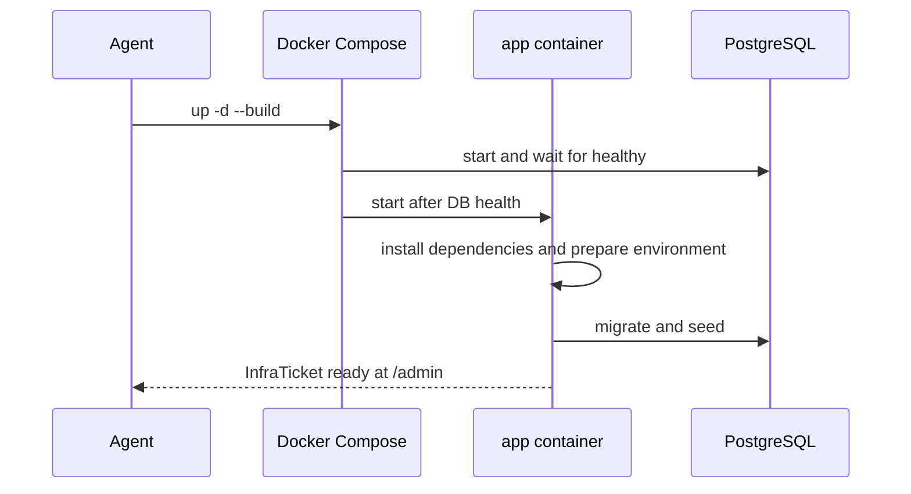

# InfraTicket Wiki Quickstart

InfraTicket is a Laravel 13 application with a Filament 5 admin panel and PostgreSQL runtime. Work from `web/`; the sibling `datos/` project is independent. This page is the first stop for an agent: start safely, identify the change boundary, run the narrowest useful check, then follow the domain page for implementation detail.

## Start safely

Run container commands from `web/`. Docker Desktop and Podman are supported; replace `docker` with `podman` when using Podman.

```bash
cd web
docker compose up -d --build
docker compose logs -f app
```

Wait for `InfraTicket ready` before opening <http://localhost:8000/admin>. The normal startup sequence installs Composer dependencies into the `infraticket-vendor` volume when needed, copies `.env.example` to `.env` only when `.env` is absent, generates an application key if necessary, runs migrations and seeders, and starts Laravel on `0.0.0.0:8000`. Do not read or edit `/web/.env`; use [`web/.env.example`](../web/.env.example) as the configuration reference. Do not commit secrets. Seeded users and any demo credentials are for local development only.



This shows the development startup ordering and the database-health dependency.

The application and database use persistent named volumes: Composer dependencies live outside the bind-mounted source tree, and PostgreSQL data persists in `infraticket-pgdata`. Stop without deleting local data with:

```bash
docker compose down
```

Use `docker compose logs -f app` for startup or application failures. Treat `migrate:fresh --seed` as destructive: use it only when deliberately rebuilding local data, never as a routine recovery step.

## Route a change to the right page

- **Runtime composition, request boundaries, or “where should this code go?”** → [System Boundaries and Runtime Composition](architecture/system-boundaries.md). It connects the panel, action layer, policies, Eloquent models, migrations, PostgreSQL, and container entrypoint.
- **Starting, configuring, recovering, inspecting logs, database access, assets, or shutdown** → [Local Runtime, Configuration, and Recovery](operations/local-development.md).
- **Roles, record visibility, or `/admin` authorization** → [Roles, Policies, and Record Visibility](concepts/authorization-and-visibility.md).
- **Users, sites, assets, role validation, and protected references** → [Users, Sites, and Assets Administration](concepts/catalog-and-user-administration.md).
- **Ticket creation, assignment, status transitions, comments, history, and concurrency** → [Ticket Lifecycle, Tracking, and Comments](workflows/ticket-lifecycle.md).
- **Entities, relationships, foreign keys, enums, versions, and migration evolution** → [Domain Data Model and Persistence Invariants](architecture/data-model.md).
- **Test layers, SQLite versus PostgreSQL, migration checks, and concurrency safety** → [Testing, Concurrency, and Change Safety](testing/test-strategy.md).

The routing rule is simple: change behavior at the layer that owns it, then update the domain page and this map if the hierarchy or responsibility materially changes. Keep implementation details out of this entry point.

## Focused checks

Run the full suite in the application container when a change crosses boundaries:

```bash
docker compose exec app php artisan test
```

For a focused feature check, use PHPUnit’s filter through the container, for example:

```bash
docker compose exec app php artisan test --filter=AdminLoginTest
docker compose exec app php artisan test --filter=TicketTrackingTest
docker compose exec app php artisan test --filter=UserManagementTest
```

Use the matching feature test rather than guessing from the class name: ticket behavior is covered by `TicketManagementTest`, `TicketResourceTest`, `TicketTrackingTest`, `TicketCommentsTest`, and related ticket tests; administration by `UserManagementTest`, `SitesAndAssetsTest`, and migration/resource tests; login by `AdminLoginTest`. Run formatting for PHP changes:

```bash
docker compose exec app vendor/bin/pint
```

The default PHPUnit configuration uses an in-memory SQLite database, so the ordinary suite does not modify the development PostgreSQL volume. PostgreSQL-specific migration, locking, and concurrent lifecycle checks require the isolated test composition and its explicitly named test database; follow the testing page rather than pointing tests at development data.

```bash
docker compose -p infraticket-test -f compose.testing.yaml up -d --build
docker compose -p infraticket-test -f compose.testing.yaml exec app composer install --no-interaction --no-scripts
docker compose -p infraticket-test -f compose.testing.yaml exec app php artisan package:discover
docker compose -p infraticket-test -f compose.testing.yaml exec app vendor/bin/phpunit
docker compose -p infraticket-test -f compose.testing.yaml down
```

After a UI or route change, verify `/admin` manually. After a persistence or workflow change, pair the focused feature test with the relevant domain page and, where locking or PostgreSQL behavior is involved, the isolated PostgreSQL suite.

## Common change-request map

| Request | First page | First check |
|---|---|---|
| Add or alter a Filament screen/resource | [System boundaries](architecture/system-boundaries.md) | Matching Livewire/Filament feature test |
| Change who can see or mutate records | [Authorization and visibility](concepts/authorization-and-visibility.md) | Role/scoping feature test |
| Add a ticket state or tracking rule | [Ticket lifecycle](workflows/ticket-lifecycle.md) | `TicketTrackingTest` and PostgreSQL checks if concurrency is affected |
| Add or change a persisted field/relationship | [Data model](architecture/data-model.md) | Migration and resource tests |
| Change users, sites, or assets | [Catalog and user administration](concepts/catalog-and-user-administration.md) | Matching administration tests |
| Change startup, environment, volumes, or test services | [Local development](operations/local-development.md) | Container startup plus the affected test layer |

When a request is not implemented yet, preserve that distinction in the relevant page: the current application includes the admin panel, users, tickets, assignment, status history, and comments, while user management from the panel, sites, assets, and a count widget may be planned or separately implemented. Confirm current source before treating a planned item as available.
