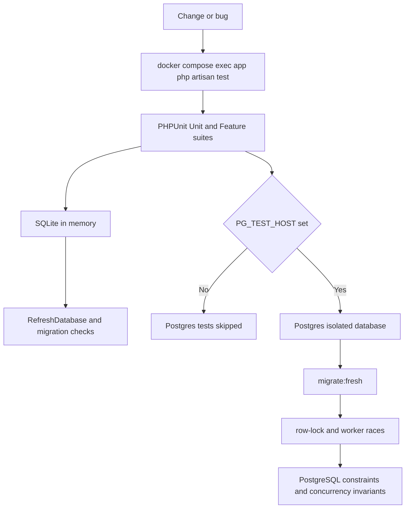

# Testing, Concurrency, and Change Safety

InfraTicket separates fast, deterministic application checks from database-specific concurrency checks. The normal PHPUnit configuration runs against an in-memory SQLite database; the PostgreSQL suites are opt-in because they start worker processes and deliberately observe row locks. The suite is behavior-oriented: it protects authorization boundaries, the ticket lifecycle, migration reversibility, persistence invariants, and optimistic-concurrency behavior rather than a configured coverage percentage.

## Test layers



This diagram shows the default SQLite path and the opt-in isolated PostgreSQL path; the latter is not a substitute for the faster application and UI checks.

### Default SQLite and PHPUnit

`phpunit.xml` defines `Unit` (`tests/Unit`) and `Feature` (`tests/Feature`) suites, sets `APP_ENV=testing`, and forces `DB_CONNECTION=sqlite` with `DB_DATABASE=:memory:`. It also uses low-cost test settings such as array cache and synchronous queues. `Tests\TestCase` loads a deliberately nonexistent testing environment file, so tests use PHPUnit/container settings rather than a developer's local environment file.

Most feature tests use Laravel's `RefreshDatabase`, factories, and the base `TestCase`. This keeps each test isolated without modifying the development PostgreSQL database. The repository has no coverage threshold; when changing behavior, add or adjust a test for the behavior and run the relevant focused test before the broader suite.

### HTTP, authorization, and Livewire/Filament

The feature layer checks both request-level access and the Filament/Livewire boundary:

- `AdminLoginTest` verifies guest redirects, login rendering, valid and invalid credentials, authenticated dashboard access, and seeded users for every `UserRole`.
- `TicketManagementTest` exercises action-level creation and update rules: the authenticated actor becomes the requester, input is trimmed and validated, protected fields cannot be forged, visibility is requester-scoped, and edit permissions vary by role and status.
- `TicketResourceTest` drives Filament pages and actions with `Livewire::test`: creating and viewing a proposal, combining table filters with visibility, denying access to another requester's record, protecting closed tickets, exposing staff views, and showing/hiding tracking actions and history.
- `TicketTrackingTest` covers assignment validation, the linear status flow, actor permissions, stale tracking versions, transaction rollback when history creation fails, stable history ordering, and protected author references.

These tests are the safety net for changes described in [Ticket lifecycle](../workflows/ticket-lifecycle.md). If a change crosses the persistence model, also consult [Data model](../architecture/data-model.md).

### Migration and persistence checks

`AdministrationMigrationsTest` proves that migrations can reset and reapply on SQLite, that normalization rejects case-insensitive email collisions without mutating existing accounts, and that adding `asset_id` preserves legacy tickets and remains reversible. The PostgreSQL administration suite repeats the important migration checks against PostgreSQL and additionally verifies database-enforced catalog constraints: referenced assets/sites cannot be deleted and duplicate asset codes are rejected.

Treat migration tests as compatibility tests, not just schema smoke tests. A migration must preserve existing records on its forward path, leave the schema usable after reversal and reapplication, and fail safely when normalization would create a collision. Avoid `migrate:fresh` against a developer database; it is used by the isolated PostgreSQL test setup because that database is disposable.

### Optional PostgreSQL concurrency layer

The PostgreSQL suites are skipped unless `PG_TEST_HOST` is present. When enabled, `PostgresTestDatabase::configure()` refuses any database name other than the exact `infraticket_test`, requires `PG_TEST_HOST`, configures the `pgsql` connection on port `5432`, and purges that connection before use. Each PostgreSQL test starts from `migrate:fresh`. The test container defines the complete contract:

```text
PG_TEST_HOST=postgres
PG_TEST_DATABASE=infraticket_test
PG_TEST_USERNAME=infraticket_test
PG_TEST_PASSWORD=test-only
```

`PG_TEST_DATABASE` must be exactly `infraticket_test`; it is not an arbitrary database selector. The host must be supplied, and the username/password must match the isolated service when using the repository Compose setup. The Compose file provisions PostgreSQL 16 with a tmpfs data directory, so the database is intentionally disposable.

The race helpers begin a transaction, acquire the relevant row or advisory administration lock, launch a PHP worker, wait until PostgreSQL reports that the worker is waiting on a lock, perform the winning operation, commit, and assert the worker's result. Ticket workers set an application name and lock timeout, then invoke the same ticket actions as production code. This makes the tests assert ordering and database behavior rather than merely calling two methods sequentially.

The concurrency invariants covered are:

- A stale `tracking_version` cannot overwrite a transition or reassignment; the winner remains persisted and the losing operation returns validation failure.
- Closing a ticket concurrently prevents a comment from being published.
- Concurrent administrator demotion or deletion cannot remove the last administrator.
- A role change racing with assignment cannot leave an invalid technician assignment; the operation that observes the changed role fails.
- Deleting an asset racing with ticket creation or update cannot create a partial ticket or silently lose an existing ticket's reference.
- A ticket saved before asset deletion keeps its reference and prevents the referenced asset from being deleted.

`PostgresTicketTest` also runs a complete requester-technician-admin workflow, checks the four status changes and two comments, and verifies final visibility and denied abilities for all roles. These checks complement, rather than replace, the SQLite lifecycle and Filament tests.

## Focused commands

Run commands from `web/` (or replace `docker compose` with `podman` when using Podman):

```bash
# Start the disposable test app and PostgreSQL service.
docker compose -f compose.testing.yaml up -d --build

# Run the default SQLite-backed suite.
docker compose -f compose.testing.yaml exec app php artisan test

# Focused behavior checks; the filter names are test classes.
docker compose -f compose.testing.yaml exec app php artisan test --filter=AdminLoginTest
docker compose -f compose.testing.yaml exec app php artisan test --filter=TicketManagementTest
docker compose -f compose.testing.yaml exec app php artisan test --filter=TicketResourceTest
docker compose -f compose.testing.yaml exec app php artisan test --filter=TicketTrackingTest
docker compose -f compose.testing.yaml exec app php artisan test --filter=AdministrationMigrationsTest

# Run the opt-in PostgreSQL administration and ticket/concurrency checks.
docker compose -f compose.testing.yaml exec app php artisan test --filter=PostgresAdministrationTest
docker compose -f compose.testing.yaml exec app php artisan test --filter=PostgresTicketTest

# Required repository formatting check after modifying PHP.
docker compose -f compose.testing.yaml exec app vendor/bin/pint

# Stop the disposable services.
docker compose -f compose.testing.yaml down
```

Use `TicketManagementTest` for action validation, identity, visibility, and protected fields; `TicketResourceTest` for Filament page/action regressions; `TicketTrackingTest` for lifecycle, history, and version invariants; and `AdministrationMigrationsTest` for SQLite migration compatibility. Use the PostgreSQL filters when changing transactions, locks, foreign keys, uniqueness, or code whose correctness depends on concurrent transactions. For an individual test, append PHPUnit's `--filter` expression to the same command.

After modifying PHP, run Pint for the modified repository code as required by the repository guidance, then rerun the narrow test and the full applicable suite. Stop the Compose services when finished so the disposable PostgreSQL container is not mistaken for a development database.
