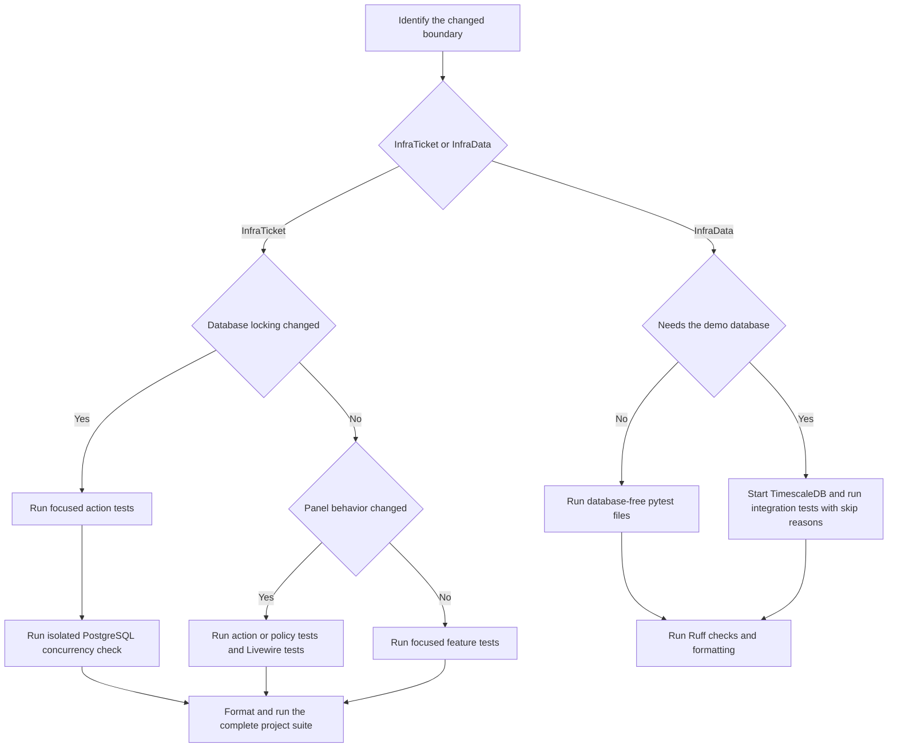

# Testing and Validation Strategy

Use the narrowest check that exercises the boundary changed, then add broader checks only where that boundary demands them. The two projects have different defaults: InfraTicket's ordinary PHPUnit suite is fast and isolated on SQLite, while InfraData's default pytest collection contains both database-free tests and PostgreSQL/TimescaleDB integration tests that may skip.



_Choose validation by the system boundary the change crosses; PostgreSQL concurrency and database-backed InfraData behavior require explicit checks beyond the fast defaults._

## What each test layer can establish

| Layer | Good evidence for | Does not establish |
|---|---|---|
| InfraTicket action/policy feature tests | Validation, protected fields, role matrices, visibility scopes, legal transitions, atomic rollback, and stale-input handling | That PostgreSQL row locks serialize two real connections |
| InfraTicket Livewire/Filament feature tests | Action visibility, form errors, notifications, redirects, escaping, filtering, pagination, and relation-manager authorization | Visual quality in a browser or PostgreSQL-specific behavior |
| InfraTicket isolated PostgreSQL harness | Real row-lock contention, one-winner/one-conflict outcomes, migrations on PostgreSQL, and consistent final state/history | General panel behavior or the complete regression suite |
| InfraData database-free pytest tests | Environment/default configuration and CLI dispatch behavior | Schema, seed data, TimescaleDB hypertables, or database reachability |
| InfraData `integration` tests and CLI smoke check | Connectivity plus expected seeded PostgreSQL/TimescaleDB data and hypertable setup | Unrelated application behavior outside the queries exercised |

## InfraTicket recipes

Run PHP commands from `web/`. The normal containerized full suite is:

```bash
docker compose exec app php artisan test
```

[`phpunit.xml`](../../web/phpunit.xml) forces `DB_CONNECTION=sqlite` and `DB_DATABASE=:memory:`. `RefreshDatabase` therefore gives ordinary feature and Livewire tests a fresh, isolated SQLite schema. This is valuable for fast regression checks, but a green run cannot prove PostgreSQL's `SELECT ... FOR UPDATE` behavior, lock waiting, or two-connection race outcomes.

### Changing incident creation, validation, visibility, or policy

1. Put business invariants at the action/policy layer and run the focused non-UI tests:

   ```bash
   docker compose exec app php artisan test tests/Feature/IncidentAccessTest.php
   ```

   [`IncidentAccessTest`](../../web/tests/Feature/IncidentAccessTest.php) checks protected creation defaults, trimming and limits, requester-versus-staff visibility, and the prohibition on update/delete. It directly exercises `CreateIncident`, the visibility scope, and gates, so failures are easier to diagnose than through the panel alone.

2. If a policy or query-scope change affects navigation or direct record access, also run:

   ```bash
   docker compose exec app php artisan test tests/Feature/IncidentPanelTest.php
   ```

   This adds Livewire coverage for create/view/list behavior, combined filters, direct URL authorization, absent edit routes, empty states, field errors, and escaped output. Keep both layers: a hidden button is not an authorization boundary, and a policy that works directly can still be wired incorrectly in Filament.

3. Run the complete suite before submission because authentication, seeding, factories, and shared migrations are cross-cutting.

### Changing assignment, status transitions, or history

Run both the domain and panel tests:

```bash
docker compose exec app php artisan test tests/Feature/IncidentTrackingTest.php tests/Feature/IncidentTrackingPanelTest.php
```

The domain test covers valid and invalid assignment targets, every status pair, the role/assignment permission matrix, the technician prerequisite for work in progress, stale operations, and rollback when history creation fails. The Livewire test covers action visibility, self-assignment, stale-confirmation notification behavior, and history relation-manager access.

`AssignIncident` and `TransitionIncident` perform their checks inside transactions after reloading the incident with `lockForUpdate`; a transition writes status and history in the same transaction. The SQLite tests establish the decision rules and rollback semantics, but not the intended PostgreSQL serialization. **Also run the real-database harness whenever changing either action, transaction boundaries, locking, conflict detection/messages, status-history writes, relevant migrations/constraints, or PostgreSQL connection configuration.**

### Running the isolated PostgreSQL concurrency harness

Start InfraTicket's containers and then run:

```bash
docker compose up -d --build
docker compose exec app php tests/Support/check-postgres-concurrency.php
```

The PostgreSQL user must be allowed to create databases; the demo container user has that permission. The script:

1. creates a randomly named `infraticket_concurrency_*` database, never the demo database;
2. applies all migrations to that database;
3. for assignment and transition separately, starts two independent PHP worker processes;
4. holds the parent incident row lock until both workers are observed waiting on a PostgreSQL lock, then releases it;
5. requires exactly one `accepted` and one `conflict` result;
6. verifies the winner's persisted assignment or status and that transition history exists exactly once.

Its `finally` block stops live workers, rolls back an open harness transaction, disconnects the test connection, force-drops only the random database, and removes the temporary barrier directory. Thus normal success and exception paths clean up without migrating, resetting, or dropping the demo database. As with any process-level cleanup, a hard kill that prevents PHP from running `finally` may require manually dropping a leftover database with the `infraticket_concurrency_` prefix.

Expected successful output reports isolated migrations and then one winner/one conflict for both `assign` and `transition`. Treat failure to reach the worker barrier or observe both lock waiters as a failed concurrency validation, not as a flaky pass.

### Changing comments or conversation presentation

Run the action/policy and panel layers together:

```bash
docker compose exec app php artisan test tests/Feature/IncidentCommentsTest.php tests/Feature/IncidentCommentsPanelTest.php
```

The first verifies authorization through incident visibility, immutable attribution, limits, status independence, and deterministic date/id ordering. The second verifies the actual relation manager: outsider rejection, escaped text, field errors, ten-row pagination, empty state, attribution, and absence of edit/delete actions. This pairing is the smallest reliable check because [`CommentOnIncident`](../../web/app/Actions/Incidents/CommentOnIncident.php) owns authorization and persisted input, while [`CommentsRelationManager`](../../web/app/Filament/Resources/Incidents/RelationManagers/CommentsRelationManager.php) owns the interaction and rendering.

### Changing the Filament panel or visible styling

Use the closest Livewire test first, then complete these checks:

```bash
docker compose exec app php artisan test
npm run build
docker compose exec app vendor/bin/pint --test
```

Review visible changes in a running browser for the requester, technician, and administrator roles that the change affects. Automated assertions can prove text and action state, but not spacing, hierarchy, responsiveness, focus behavior, or clipping. Compare UI/UX changes against [`DESIGN.md`](../../web/DESIGN.md). Include before/after or role-specific screenshots when the panel's visible output changes; screenshots are especially appropriate for new pages, changed actions/forms, empty/error states, responsive layout, or a design-system change.

`npm run build` is the repository's frontend compile check; there is no separate JavaScript lint script in `package.json`. For PHP formatting, use `vendor/bin/pint --test` as a non-mutating check and `vendor/bin/pint` to apply formatting:

```bash
docker compose exec app vendor/bin/pint --test
docker compose exec app vendor/bin/pint
```

## InfraData recipes

Run commands from `datos/`. Pytest registers `integration` for tests requiring the Docker Compose database, while Ruff checks `src` and `tests` with the configured error, import, upgrade, and bugbear rule families.

### Changing configuration or CLI dispatch only

Use the database-free tests:

```bash
uv run pytest tests/test_config.py tests/test_cli.py
```

These prove `DATABASE_URL` fallback/override behavior and the unknown-command usage/exit code without needing PostgreSQL. If the successful `check` command, connection helper, SQL, schema assumptions, or dataset summary changes, this is no longer sufficient; use the database-backed recipe.

To run all database-free tests explicitly as that set grows:

```bash
uv run pytest -m "not integration"
```

### Changing database access, schema assumptions, or seeded analytics data

Start the TimescaleDB service, verify the runtime path, and run integration tests while displaying skip reasons:

```bash
docker compose up -d
uv run python -m infradata check
uv run pytest -m integration -rs
```

The Compose database is exposed on host port `5433`, matching InfraData's default URL. The current integration fixture attempts a connection with a two-second timeout and calls `pytest.skip` on `psycopg.OperationalError`. Consequently, `uv run pytest` can be green while all database tests were skipped. **A green run with skips is not database-backed validation.** Inspect the summary from `-rs` and require the integration tests to execute without skips when the change depends on PostgreSQL, the seed dataset, UTC timestamps, or TimescaleDB's `readings` hypertable.

The integration checks currently verify the twelve seeded sensors, the expected reading date range, and hypertable registration. The CLI smoke check additionally exercises the user-facing success path through `connect()` and its aggregate query. For a final project check with the database available, run the unfiltered suite:

```bash
uv run pytest -rs
```

Do not mistake container startup for readiness; if the first attempt reports the database-unreachable skip, wait for the Compose health check and rerun. Also remember that `db/init/` scripts run only when a new database volume is initialized, so an old local volume may not represent a changed initializer.

### InfraData linting and formatting

Run the configured lint and format checks on every Python change:

```bash
uv run ruff check .
uv run ruff format --check .
```

Apply formatting with:

```bash
uv run ruff format .
```

Then rerun the focused tests. The completion gate in [`datos/AGENTS.md`](../../datos/AGENTS.md) is stricter than a database-free green run: lint must pass and the full pytest suite must pass with the database running.

## Final validation checklist

### InfraTicket

- Focused action/policy tests cover the changed invariant and unauthorized path.
- The corresponding Livewire test covers panel wiring when forms, actions, tables, notifications, or relation managers changed.
- The isolated PostgreSQL harness passes for lock-, transaction-, assignment-, or transition-sensitive changes.
- `docker compose exec app php artisan test` passes.
- `docker compose exec app vendor/bin/pint --test` passes; `npm run build` passes when frontend assets are involved.
- Visible panel changes were reviewed against `DESIGN.md` in a browser and documented with screenshots where appropriate.

### InfraData

- Database-free tests cover pure configuration/dispatch logic.
- Database-dependent changes were tested with TimescaleDB reachable, and `-rs` confirms there were no database-unreachable skips.
- `uv run python -m infradata check` succeeds for runtime/database changes.
- The full suite, `uv run ruff check .`, and `uv run ruff format --check .` pass.

## Related documentation

- [InfraData Runtime](../architecture/infradata-runtime.md)
- [InfraTicket Panel](../architecture/infraticket-panel.md)
- [Local Development](../operations/local-development.md)
- [Incident Management](../workflows/incident-management.md)
