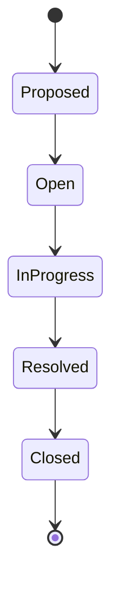
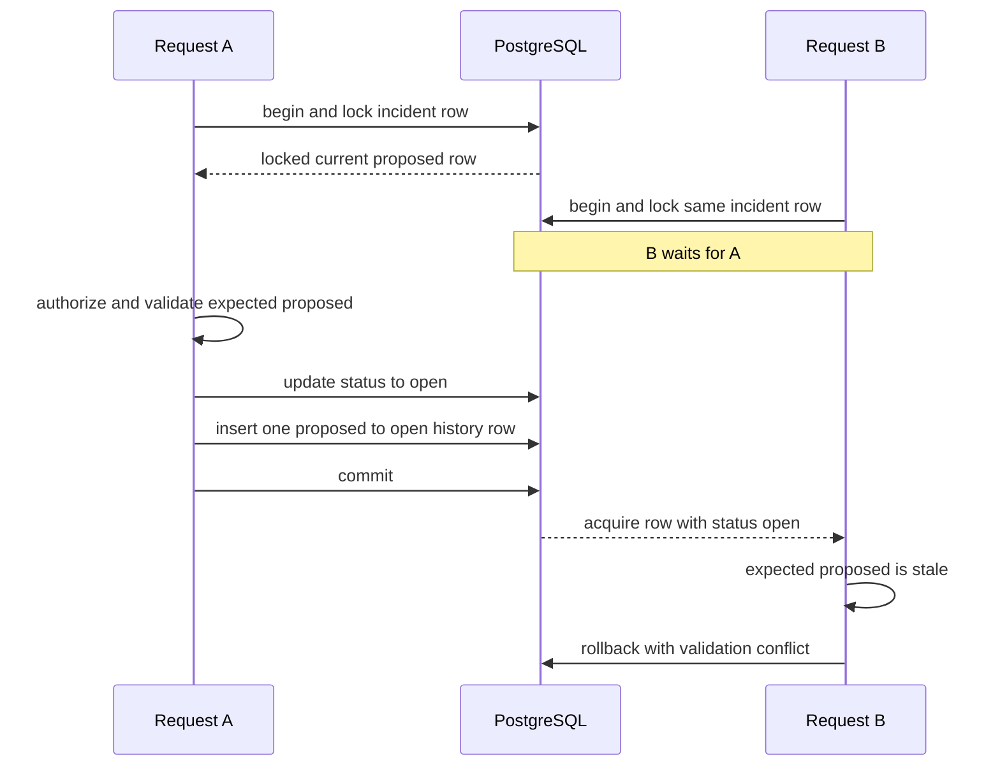

# Incident Creation, Assignment, Transition, and Comment Workflows

InfraTicket keeps workflow rules in four action classes rather than allowing general record editing. The Filament pages collect input and display results, policies decide who may act, and the actions re-authorize and enforce domain invariants. This separation is important: **assignment changes only `technician_id`**, whereas **a transition changes `status` and appends exactly one audit-history row in the same transaction**.

For the surrounding panel structure and domain model, see [InfraTicket Panel](../architecture/infraticket-panel.md) and [Incident Domain](../concepts/incident-domain.md). For the broader test approach, see [Validation Strategy](../testing/validation-strategy.md).

## Workflow entry points

| User operation | Panel entry point | Domain action | Persistence behavior |
|---|---|---|---|
| Create | `Pages\CreateIncident::handleRecordCreation()` | `CreateIncident::handle()` | Validates and inserts one incident with protected defaults. |
| Assign or reassign | `ViewIncident` action `assign` | `AssignIncident::handle()` | Transactionally locks the incident and target user, then updates only `technician_id`. |
| Self-assign | `ViewIncident` action `selfAssign` | `AssignIncident::handle()` | Uses the same assignment action with the signed-in technician's ID. |
| Advance status | `ViewIncident` action `transition` | `TransitionIncident::handle()` | Transactionally locks the incident, updates its status, and inserts one history row. |
| Comment | `CommentsRelationManager` action `comment` | `CommentOnIncident::handle()` | Re-fetches and authorizes the incident, then inserts an attributed comment. |

The action layer is the authoritative mutation boundary. In particular, submitted ownership, status, technician, author, incident, and timestamp fields are not trusted merely because a caller supplies them.

## Creation and protected defaults

`CreateIncident` first authorizes `create` through `IncidentPolicy`; the current policy permits every authenticated role to create. It trims string input and validates:

- `title`: required string, at most 255 characters;
- `description`: required string, at most 10,000 characters;
- `priority`: a valid `IncidentPriority`, defaulting to `medium` when omitted.

The action itself supplies the security- and lifecycle-sensitive fields: `requester_id` is the actor, `status` is `proposed`, and `technician_id` is `null`. Caller-provided values for those fields are ignored. Creation does not write status history: `proposed` is the initial state, not a transition.

The Filament create page delegates to the action, remaps action validation keys to its `data.*` form fields, and redirects to the new incident's view page. The database repeats the `proposed` and `medium` defaults as a persistence backstop, requires a valid requester, and permits a nullable technician.

## Exact status lifecycle

`IncidentStatus::next()` defines one forward successor for each nonterminal state:



*The incident lifecycle is strictly `proposed` → `open` → `in_progress` → `resolved` → `closed`, with no skip, backward, or reopen edge.*

A technician is **not** required for `proposed` → `open`, but the incident must have a non-null `technician_id` before `open` → `in_progress`. The prerequisite is checked against the locked current row. Once closed, `next()` returns `null`, and the panel hides the transition action.

`TransitionIncident` accepts both an `expectedStatus` captured when confirmation was opened and a requested `target`. Under the incident row lock it applies these checks in order:

1. authorize the actor against the current database row;
2. reject the operation if current status differs from `expectedStatus`;
3. require `current.status.next()` to equal `target`;
4. require a technician when the target is `in_progress`;
5. update the status and create history with `actor_id`, `from_status`, and `to_status`.

Only an administrator or the currently assigned technician may transition. Requesters and unassigned or differently assigned technicians are rejected by policy.

## Assignment is not a transition

`AssignIncident` has deliberately different semantics:

- An administrator may choose a user with the technician role and may reassign an incident in any status.
- A technician may assign only a currently unassigned incident and only to themself.
- A requester cannot assign.
- A missing user or a user without the technician role is rejected.

The action authorizes once before starting the transaction, then locks and reloads the incident and authorizes again against that current row. This second check closes the gap between a stale UI decision and current assignment state. It also locks the selected user row before validating the target's technician role and updating the incident.

Assignment has no expected-status parameter and does not implement general optimistic reassignment for administrators: admin reassignment is intentional last-committer behavior serialized by the incident lock. The stale-assignment conflict specifically protects technician self-assignment—after one technician claims a free incident, a waiting technician sees it as assigned and is rejected. Regardless of actor or incident status, a successful assignment neither changes `status` nor creates `IncidentStatusHistory`.

## Locking, atomicity, and stale confirmations

Both assignment and transition use `DB::transaction()` and `SELECT ... FOR UPDATE` through `lockForUpdate()` on the incident. Competing mutations of the same incident therefore serialize. The transition UI stores the status at confirmation mount in the Livewire `#[Locked]` property `transitionOrigin`; execution converts that snapshot back to `IncidentStatus` and passes it as the expected status.



*Concurrent transitions serialize on the incident row: one request commits the status and history atomically, while the waiter rejects its stale expectation.*

Status update and history insertion share one transaction. Consequently, a failure while creating history rolls back the preceding status update, and a stale or invalid transition leaves both status and history unchanged. There is no interval in which a committed new status lacks its audit row.

Assignment also rolls back as a unit on validation or authorization failure, but it has no history write to persist. Creation and commenting are single-record inserts and do not use this row-locking transaction protocol.

## Audit history

Every successful transition creates one `incident_status_histories` row containing the incident, actor, old status, new status, and timestamps. The relation orders entries by `created_at` and then `id`, giving deterministic order when timestamps coincide. History actors are protected by a restrictive foreign key, while deleting an incident cascades its history.

The view page dispatches `incident-updated` after a successful assignment or transition. `StatusHistoryRelationManager` listens for that event and resets its table when the event's incident ID matches its owner. The table is read-only in workflow terms and is visible only when the user may view the incident.

## Comments

`CommentOnIncident` reloads the incident by ID, authorizes comment creation through `IncidentCommentPolicy`, trims the body, and requires a string of 1–5,000 characters. The policy delegates comment creation and viewing to permission to view the parent incident. Thus administrators and technicians can comment on all incidents, while a requester can comment only on their own; status, including `closed`, does not disable commenting.

Attribution is server-owned: the parent relation supplies `incident_id`, the action supplies the authenticated actor as `author_id`, and Eloquent supplies timestamps. Forged values in input are ignored. Comments are ordered by `created_at` and then `id`; the panel presents paginated, escaped text with author and date. Policies deny comment update and deletion for every role, so comments form an append-only conversation at the application boundary.

## User-facing success and failure behavior

`ViewIncident::performChange()` centralizes assignment and transition feedback:

- on success, it refreshes the record and requester/technician relations, dispatches `incident-updated`, and shows **“Incidencia actualizada”**;
- on `ValidationException`, it shows the danger notification **“No se pudo actualizar la incidencia”** with the validation message, refreshes the record, and throws Filament's `Halt` so the failed action stops cleanly.

Important validation failures are intentionally actionable:

| Condition | Message |
|---|---|
| Confirmation expected an older status | `El estado ha cambiado. Actualiza la ficha.` |
| Requested edge is not the immediate successor | `La transición de estado no está permitida.` |
| Starting work without assignment | `Asigna un técnico antes de pasar a en curso.` |
| Technician tries to claim an already assigned incident | `La incidencia ya está asignada. Actualiza la ficha.` |
| Assignment target is absent or not a technician | `Selecciona un usuario con rol técnico.` |

Authorization failures are separate from validation conflicts: Filament action authorization and the action's own policy checks prevent unauthorized calls rather than translating them into the conflict notification. Comment validation remains attached to the comment form field. The create page similarly remaps validation errors onto create-form fields.

## Safe extension points and invariants

When changing this workflow:

- Add or reorder lifecycle states in `IncidentStatus::next()` and update transition tests as one change; the action intentionally accepts only that map.
- Keep transition authorization and invariant checks **inside** the row-locked transaction. UI visibility is convenience, not enforcement.
- Preserve the expected-status argument and confirmation snapshot if the UI changes; they are what turn a delayed confirmation into a stale conflict rather than an accidental second transition.
- Keep status update and history creation in the same transaction. Moving history to an asynchronous or post-commit path would change the audit guarantee.
- Do not add history creation to assignment unless the domain explicitly gains an assignment-audit concept; current status history records only lifecycle transitions.
- Route new creation or comment fields through action validation and assign ownership/attribution on the server.

## Focused verification

The main feature suites establish complementary guarantees:

- `IncidentAccessTest` covers protected creation defaults, trimming, limits, enum priority validation, and role-based visibility.
- `IncidentTrackingTest` exhaustively checks every status pair, role permissions, assignment targets, technician prerequisites, stale operations, exact history attribution, and rollback when history insertion fails.
- `IncidentTrackingPanelTest` checks action visibility, successful refresh/history display, and the stale-confirmation notification without duplicate history.
- `IncidentCommentsTest` checks every role and status, immutable attribution, validation limits, authorization, and deterministic ordering.
- `IncidentCommentsPanelTest` checks escaped rendering, pagination, no edit/delete actions, and form-level errors.

Run the ordinary suite in the application container:

```bash
docker compose exec app php artisan test
```

Those tests normally use SQLite and validate transaction outcomes, but not real PostgreSQL lock contention. The dedicated concurrency check creates and migrates a random temporary PostgreSQL database, starts two independent worker processes for assignment and then transition, forces both to contend on the same parent row lock, and requires exactly one `accepted` result and one `conflict` result:

```bash
docker compose exec app php tests/Support/check-postgres-concurrency.php
```

For assignment it additionally asserts that one technician won while status remained `proposed` and history stayed empty. For transition it asserts status became `open` and exactly one history row exists. The script drops only its temporary database in `finally`, including after failures.
