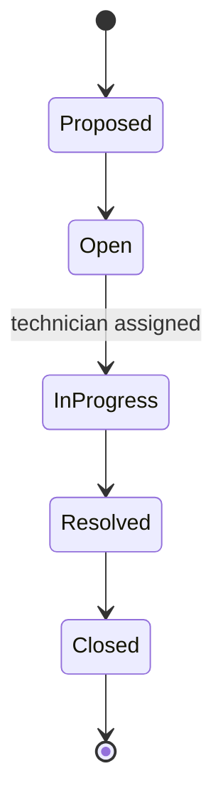
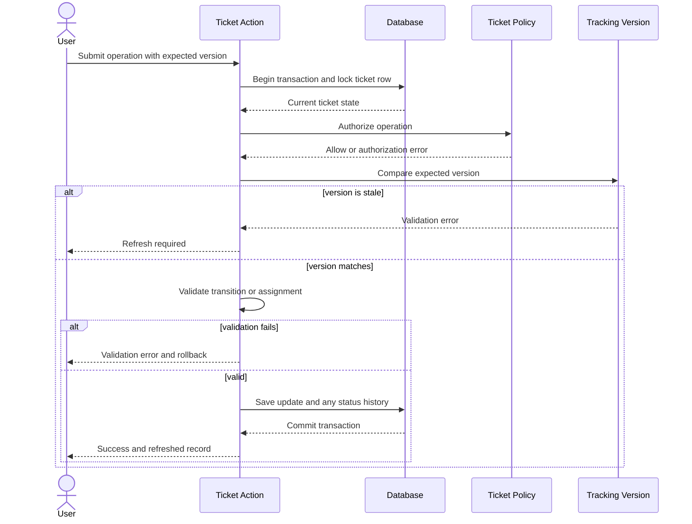

# Ticket Lifecycle, Tracking, and Comments

A ticket is created by an authenticated user in `Proposed` status. The workflow is deliberately linear: a ticket can advance through each next status exactly once and cannot be reopened. Assignment and state-changing operations use a tracking version together with database row locks so concurrent actions fail safely instead of overwriting one another.

## Lifecycle

This state diagram shows the only forward lifecycle; there are no backward or reopen transitions.

`CreateTicket` authorizes creation, validates the supplied ticket data, associates the actor as requester, sets `TicketStatus::Proposed`, saves inside a transaction, and returns a refreshed ticket. `TicketStatus::next()` is the source of truth for the permitted successor: `Proposed` → `Open` → `InProgress` → `Resolved` → `Closed`. `TransitionTicket` rejects any target other than the current status's immediate successor. It also requires a technician before the `Open` → `InProgress` transition. Every successful transition increments `tracking_version` and creates a status-change record containing the previous status, new status, and acting user's id.

There is intentionally no reopen path. `Closed::next()` is `null`, and the transition policy rejects all actions on a closed ticket. The policy also returns `false` for both `delete` and `deleteAny`; tickets are not deleted through the policy-protected workflow.

## Visibility and permissions

- Any user may create a ticket. Requesters can view only tickets whose `requester_id` is their own; non-requesters can view tickets without that requester restriction. The list query uses the same `Ticket::visibleTo()` scope, so a requester cannot discover another requester's ticket through the resource list.
- Updating is allowed only when the ticket is visible to the actor, is not closed, and— for a requester— is still `Proposed` or `Open`. Staff are not limited by those requester-only status restrictions, but closed tickets remain immutable.
- Assignment is staff-only (requesters cannot assign) and is unavailable after closure. The assigned value must identify a user with the technician role. Removing an assignment is allowed only while the ticket is `Proposed` or `Open`; later states require a technician.
- Transitioning is allowed to an open ticket only for an admin or the technician currently assigned to it. The action still enforces the linear successor and the technician prerequisite described above.
- Commenting requires the same visibility rule as viewing and is disallowed after closure. A requester, technician, or admin can comment on a visible, open ticket without being assigned to it. Comment bodies are trimmed and must contain 1–5,000 characters; the action records the authenticated actor as `author_id`, ignoring caller-supplied identity and timestamp fields.
- Comments and status history are visible only when the parent ticket is visible. The relation managers re-authorize the freshly loaded parent before querying, which prevents direct relation access from bypassing ticket visibility.

These rules are enforced in `TicketPolicy` and again at the action boundaries rather than relying only on the UI's hidden or disabled actions. After closure, existing comments and status history remain readable to users who can view the ticket, but the conversation is read-only and no ticket edit, assignment, transition, comment, or delete operation is permitted.

## Assignment, versions, and safe concurrency

`AssignTicket`, `TransitionTicket`, `UpdateTicket`, and `AddTicketComment` run in database transactions and reload the current ticket with `lockForUpdate()`. Assignment also locks the shared users administration record before reloading the ticket. The tracking actions receive the version shown to the user, compare it with the locked row through `TrackingVersion::check`, and reject a mismatch with a validation error telling the user to refresh. Assignment and successful transitions increment the version; comments and ordinary updates do not use a version check.

This sequence shows the locked-row/version/error path used by tracking actions; the transaction boundary also makes a failed history write atomic with the ticket change.

The lock is important even when the version check is present: two workers cannot both read and commit the same ticket state. A worker that waits for the row lock reloads the winner's committed state, then its stale expected version fails. Consequently, a concurrent transition produces one status change, and a concurrent reassignment cannot overwrite the first technician. If creation of the status-history record fails, the transaction rolls back both the status and version, leaving no partial history.

The Filament ticket view captures the current `tracking_version` when opening assignment or transition actions. On validation failure it maps the error back onto the mounted action, refreshes the record after success, dispatches `ticket-updated`, and reports the result. This is a UI integration detail; callers of the action classes must still supply the expected version themselves.

## Comments and history in the ticket view

The comments relation displays body, author, and timestamp, orders records by creation time and id, and paginates the conversation. Output is escaped by the UI. The comment action trims input and uses the actor supplied to `AddTicketComment`, so clients cannot impersonate another author by including `author_id` in the payload.

The status-history relation displays the previous and new statuses, author, and timestamp. `Ticket::statusChanges()` orders by `created_at` and then `id`, providing stable ordering when records share a timestamp. History is append-only from the ticket workflow: it is created as part of a successful transition, while assignment changes do not create status-history entries.

## Focused verification

- `web/tests/Feature/TicketTrackingTest.php` covers the linear state matrix, the technician prerequisite, assignment constraints, role-based transition authorization, stale versions, rollback when history creation fails, stable history ordering, and protected author references.
- `web/tests/Feature/TicketCommentsTest.php` covers actor identity, trimming and length validation, requester visibility, closed-ticket read-only behavior, escaped and paginated comments, and protection of relation managers against direct visibility bypass.
- `web/tests/Feature/PostgresTicketTest.php` exercises the complete requester-technician-admin workflow and PostgreSQL concurrency races for transitions, reassignment, and closing while a comment is in flight. It verifies that row locking and version checks prevent lost updates and publication after closure.

For related authorization and visibility concepts, see [Authorization and Visibility](../concepts/authorization-and-visibility.md). For the broader entity relationships, see [Data Model](../architecture/data-model.md).
