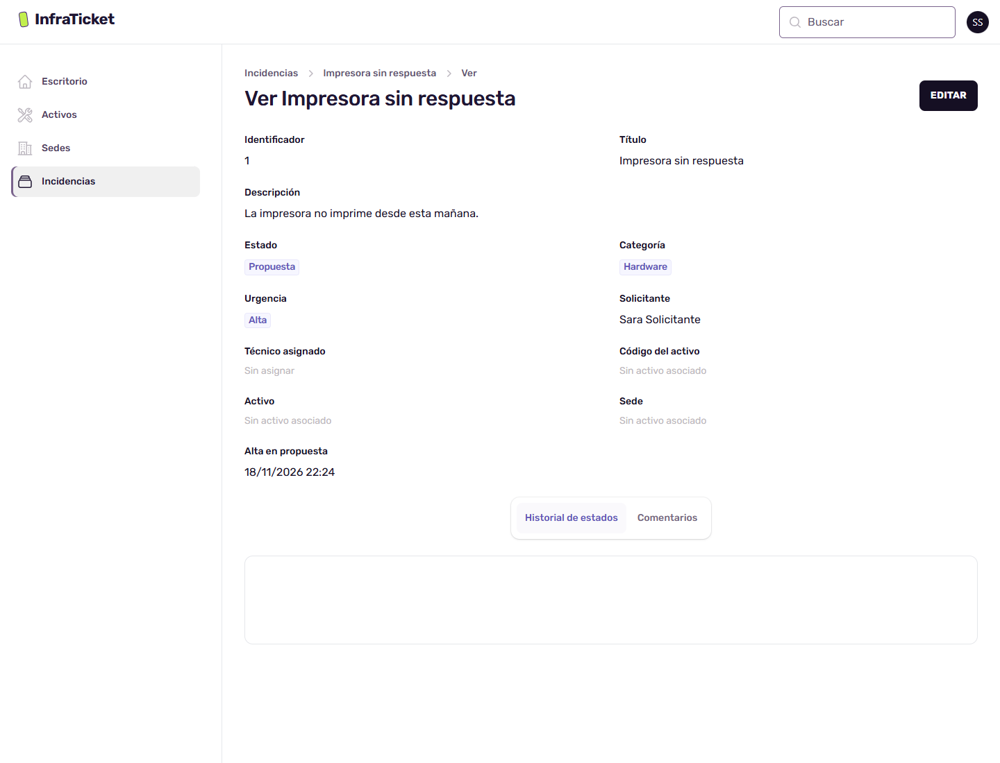
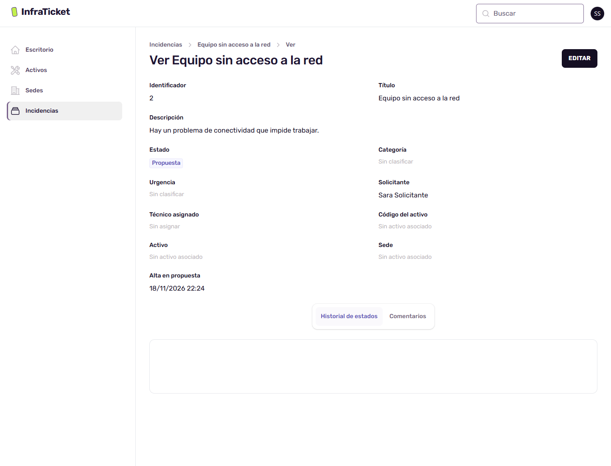
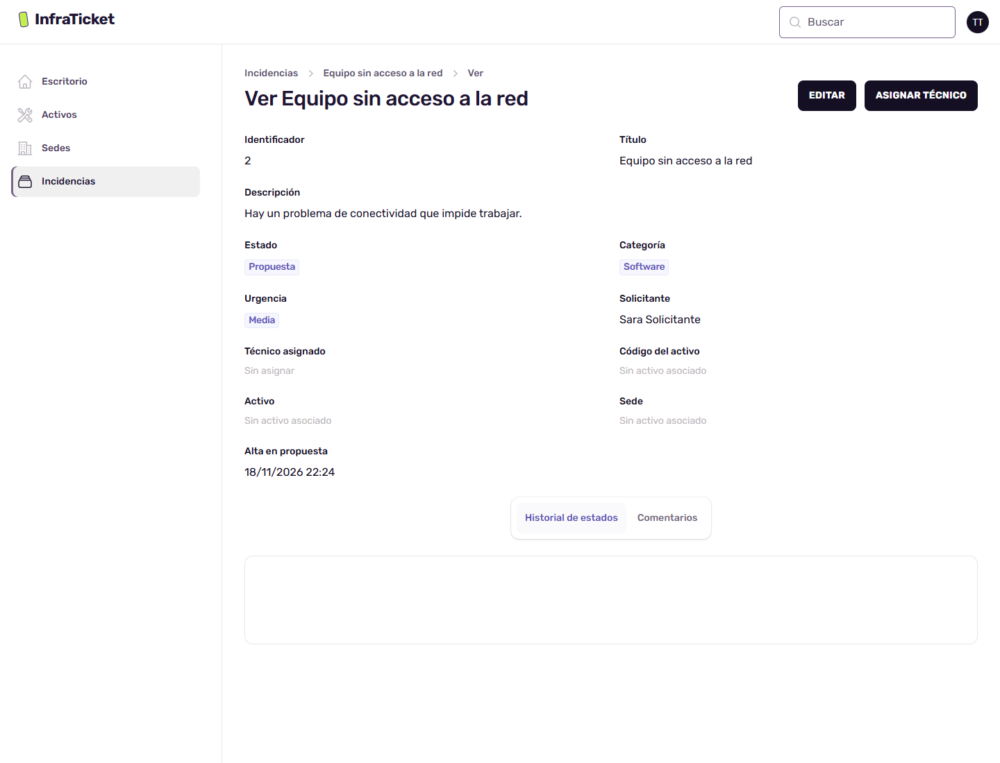

# Clasificación de incidencias

Las nuevas incidencias se clasifican a partir de su descripción. El alta no pide categoría ni urgencia manuales. La urgencia se guarda en `priority`, con valores baja, media, alta y crítica; las categorías son Hardware, Software, Red, Accesos y Otros.

Una clasificación completa requiere ambos valores. Si falla el análisis, ambos quedan vacíos y el panel muestra «Sin clasificar», independientemente del estado de atención. «Otros» es una categoría válida y no indica un fallo.

La migración conserva las prioridades históricas y deja sus categorías vacías. Esos registros muestran «Sin clasificar» junto a su urgencia histórica y permiten editar datos básicos sin forzar una clasificación. La factory predeterminada representa un registro histórico; `classified()` y `unclassified()` permiten preparar los otros dos casos sin llamar al proveedor. El seeder de usuarios no requiere cambios ni realiza inferencias.

## Migración y reversión

Desplegar migración y código de forma coordinada, sin mezclar versiones. No se reclasifican registros anteriores. La reversión elimina las categorías: conservar una copia completa antes de usarla. Si quedan prioridades nulas, la reversión se detiene; el equipo debe decidir la urgencia de esas incidencias antes de volver al código o esquema anterior. No se rellenan prioridades ficticias.

## OpenRouter y configuración

El 18 de noviembre de 2026 se consultó el catálogo público [Models](https://openrouter.ai/api/v1/models): openai/gpt-oss-120b anuncia response_format y structured_outputs. El valor lógico OPENROUTER_MODEL=gpt-oss-120b se resuelve explícitamente a ese identificador. No se cambia de modelo si falla o no hay proveedor compatible.

| Variable del servidor | Valor predeterminado |
| --- | --- |
| OPENROUTER_API_KEY | vacío |
| OPENROUTER_MODEL | gpt-oss-120b |
| OPENROUTER_TIMEOUT_SECONDS | 10 |
| OPENROUTER_CONNECT_TIMEOUT_SECONDS | 3 |
| OPENROUTER_RETRY_DELAY_MS | 250 |

La clave se configura mediante el mecanismo de secretos del servidor y nunca mediante una variable VITE_ ni desde el navegador. El archivo de ejemplo contiene únicamente una referencia sin secretos. Sin clave o con configuración inválida, se guarda «Sin clasificar» sin llamar al proveedor.

El backend envía únicamente la descripción como contenido del usuario, junto con las instrucciones y el esquema. La descripción se transmite a OpenRouter; deben aplicarse las condiciones de tratamiento del proveedor. Se exige salida estructurada y se valida localmente el mismo JSON Schema con Opis 2.6.2; no se reparan respuestas mal formadas.

Se realiza un intento inicial y hasta dos reintentos ante errores HTTP, conexión, tiempo agotado o contenido inválido. Cada llamada dura como máximo 10 segundos, con conexión de hasta 3 segundos dentro de ese límite, y hay dos esperas de 250 ms como máximo. El presupuesto remoto predeterminado es 30,5 segundos más procesamiento y guardado. Configura el timeout del servidor y proxy por encima de ese presupuesto. No hay llamadas durante la transacción de guardado.

Los logs solo contienen correlación, número de intento, resultado, causa controlada y código HTTP cuando existe. No incluyen claves, cabeceras, descripciones ni respuestas completas.

## Revisión en Filament

Los solicitantes describen el problema y pueden editar título, descripción y activo en los estados permitidos. La clasificación es visible y solo la corrigen técnicos y administradores en incidencias no cerradas. Para cambiarla hay que indicar categoría y urgencia válidas; las peticiones manipuladas se rechazan en el backend. La edición de descripción o clasificación nunca llama de nuevo al modelo.

Ejemplo: una propuesta «Hardware / Alta» puede corregirse a «Software / Media». Una incidencia «Sin clasificar» puede completarse con ambos valores. Una incidencia antigua con prioridad alta conserva esa prioridad mientras se edita su descripción, aunque todavía no tenga categoría.

## Evidencia de revisión

Se revisó el panel en Chrome local con Playwright, a 1440 × 1100, sobre una base SQLite exclusiva del contenedor de pruebas. No se usaron credenciales reales ni inferencias de pago.

1. Sara Solicitante creó una incidencia sin elegir clasificación; el backend simulado propuso Hardware / Alta y conservó el estado Propuesta.
2. La segunda descripción provocó tres respuestas HTTP 503 simuladas; el alta terminó como «Sin clasificar», también en Propuesta.
3. Tomás Técnico completó la segunda incidencia con Software / Media. La ficha conservó los valores y dejó de indicar «Sin clasificar». Chrome no registró errores de JavaScript.

El servidor de revisión utiliza el lanzador aislado existente, tests/Support/preview.php, con REVIEW_CLASSIFICATION=1. En ese modo se simulan fallos para descripciones que contengan «conectividad» y una propuesta válida para las demás. Es una ayuda exclusiva de pruebas: no altera la integración de producción. Ver [informe de verificación](ticket-classification-verification.md) para los resultados automatizados.

## Actualización de dependencias en Docker

El volumen de dependencias puede conservar una instalación anterior aunque se reconstruya la imagen. Si aparece «Class Opis\JsonSchema\Validator not found», sincroniza el volumen del contenedor de desarrollo con composer install.

El arranque compara composer.lock con vendor/.composer-installed.lock y ejecuta Composer cuando cambia el lockfile o falta el autoloader. Solo guarda la copia del lockfile tras una instalación correcta. Así, un reinicio incorpora nuevas dependencias sin reinstalarlas en cada arranque.
